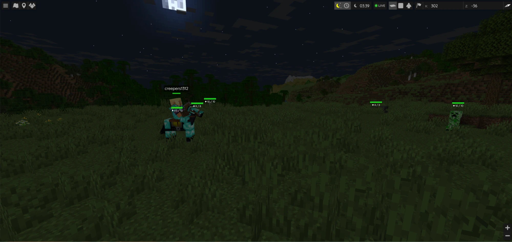
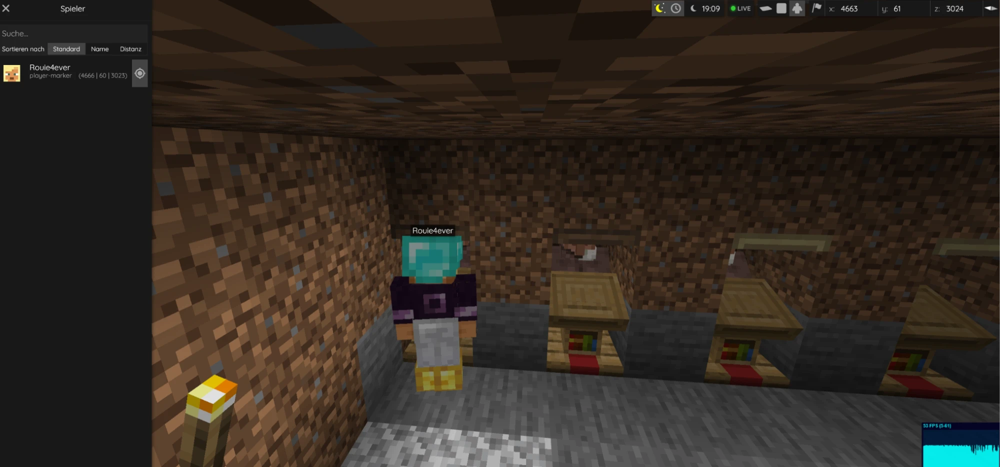
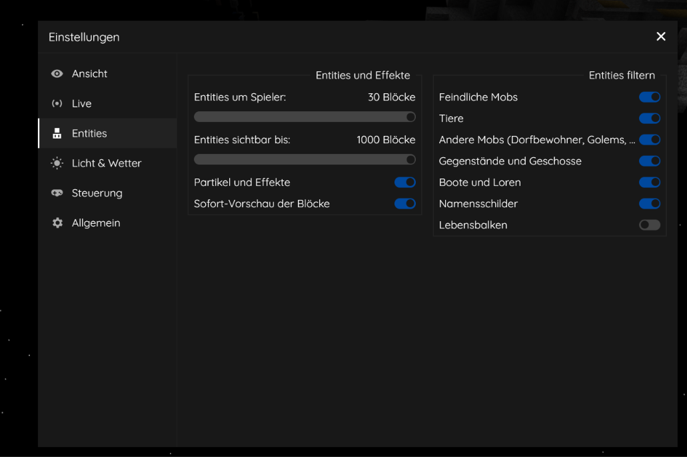
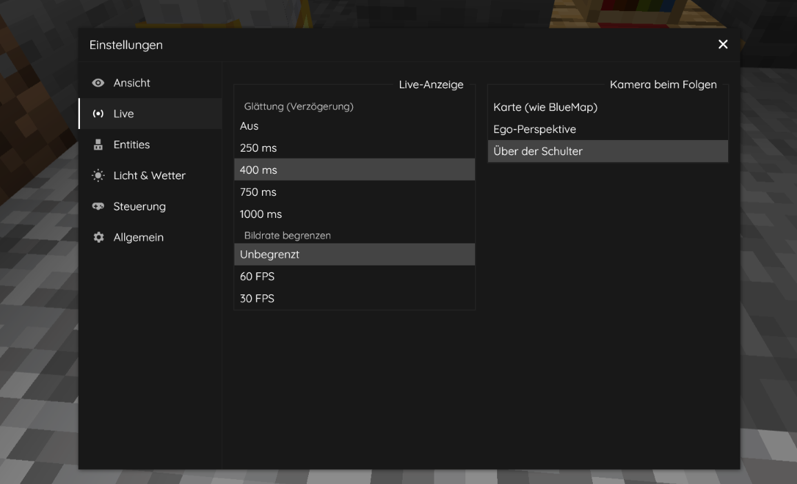

# BlueMap Live

**English** · [Deutsch](README.de.md)

BlueMap Live is an unofficial fork of [BlueMap](https://github.com/BlueMap-Minecraft/BlueMap) that shows your Minecraft world **live** on the 3D map: players with their skins and animations, mobs, items, effects, block changes, the time of day and the weather.

It extends the original map and does not replace it. The map, its textures, the web client, the navigation and the webserver are BlueMap's own; the live content is drawn on top.

> Not made by the BlueMap team. Please report problems [here](https://github.com/Creepers1312/BlueMap-Live/issues), not at the original project.



## Features

| | |
|---|---|
| **Players** | 3D models with skin, walking, sneaking, swimming, flying with elytra, riding, sleeping, held items with their animations (bow, crossbow, shield, trident, eating, …), armor with trims, dynamic light from torches in the hand |
| **Entities** | dropped items, thrown items, arrows and tridents with their flight, vanilla mobs with textures and animations, boats and minecarts, leashes, placeholders for other creatures |
| **Effects** | explosions, potions, fire, smoke |
| **Blocks** | changed blocks appear at once as a preview, with the light of their surroundings, until BlueMap has rendered the tile again; chests open and close |
| **World** | the day-night cycle of the world, live weather with sun, moon phases, stars, clouds, rain, snow and lightning, a world clock |
| **Map controls** | settings in a popup with tabs, quality presets, entity filter, name tags, health bars, following a player in first person or over the shoulder, a LIVE indicator, 28 languages |
| **Server** | `/bluemap live-stats` shows what the live data costs; the metrics reports of the original BlueMap are off by default (`metrics` in `core.conf`) |



<p>
  
  
</p>

<!-- screenshot: docs/images/weather.webp (rain or a thunderstorm) -->

## Download

Downloads are on the [releases page](https://github.com/Creepers1312/BlueMap-Live/releases/latest). Each release has one jar per platform:

| Platform | File | Status |
|---|---|---|
| Fabric (Loader ≥ 0.17.2 and Fabric API) | `bluemap-live-<version>-fabric.jar` | tested in Minecraft |
| NeoForge | `bluemap-live-<version>-neoforge.jar` | new in 1.0, the tests in Minecraft are still open |
| Forge | `bluemap-live-<version>-forge.jar` | new in 1.0, the tests in Minecraft are still open |

Minecraft Java Edition **1.21.1** (and 1.21). Works in singleplayer and on dedicated servers. Only the server needs the mod; players use their browser.

## Installation

1. Remove the original BlueMap jar from the `mods` folder (both together do not work).
2. Put the BlueMap Live jar for your platform into the `mods` folder.
3. Start the server or world. As in BlueMap, accept the download of the Minecraft resources once in `config/bluemap/core.conf` (`accept-download: true`).
4. Open the map in the browser: `http://localhost:8100` by default.

Existing BlueMap configs and maps are kept. BlueMap's own documentation applies to everything that is not live: [bluemap.bluecolored.de/wiki](https://bluemap.bluecolored.de/wiki/).

## Configuration

The live settings are in `config/bluemap/plugin.conf`. All of them are on by default:

| Setting | Default | What it does |
|---|---|---|
| `live-player-markers` | `true` | sends the players to the map |
| `live-player-update-interval` | `250` | milliseconds between two samples (50–10000); lower is smoother but costs more |
| `live-player-extended-data` | `true` | body rotation, movement, items, armor, …; `false` sends only name, position and rotation |
| `live-entities` | `true` | items, projectiles, mobs and vehicles around the players |
| `live-entities-radius` | `30` | blocks around each player (0–128) |
| `live-entities-limit` | `200` | entities per map, the nearest first (0–1000) |
| `live-entities-hidden-types` | `[]` | entity types that are never sent, e.g. `["minecraft:item"]` |
| `live-block-updates` | `true` | changed tiles are rendered again after a short cooldown |
| `live-block-preview` | `true` | changed blocks are shown at once as a preview |
| `live-block-preview-radius` | `96` | blocks around the players (0–256) |
| `live-block-update-cooldown` | `10` | seconds until a changed region is rendered again |

Only things around players that are visible on the map are sent; hidden players and their surroundings stay hidden. All settings, including the ones in the browser, are described in [docs/bluemap-live/configuration.md](docs/bluemap-live/configuration.md).

## Performance

The server only samples the positions and states (a few field reads per entity, by default 4 times per second). Drawing the models, animations and weather is done by the browser of each viewer. The quality presets in the settings (Performance, Balanced, Beautiful) set how much the browser draws.

## Building

```sh
./gradlew release
```

The jars are in `build/release/`. Java 21 is needed. The tests of the web client run with `npm test` in `common/webapp`.

## Documentation

- [docs/bluemap-live/README.md](docs/bluemap-live/README.md): an overview of all documents
- [CHANGELOG.md](CHANGELOG.md): what changed in each version
- [docs/bluemap-live/roadmap.md](docs/bluemap-live/roadmap.md): what comes next (1.x: support for mod entities)

## Credits and license

BlueMap is made by [Blue (TBlueF, Lukas Rieger)](https://github.com/TBlueF) and the [BlueMap contributors](https://github.com/BlueMap-Minecraft/BlueMap/graphs/contributors). BlueMap Live builds on it and keeps its license: MIT, see [LICENSE](LICENSE). The original README is at [BlueMap-Minecraft/BlueMap](https://github.com/BlueMap-Minecraft/BlueMap#readme).

Minecraft textures and models are not part of this repository. Like BlueMap, the mod downloads them from Mojang after you accept it.
