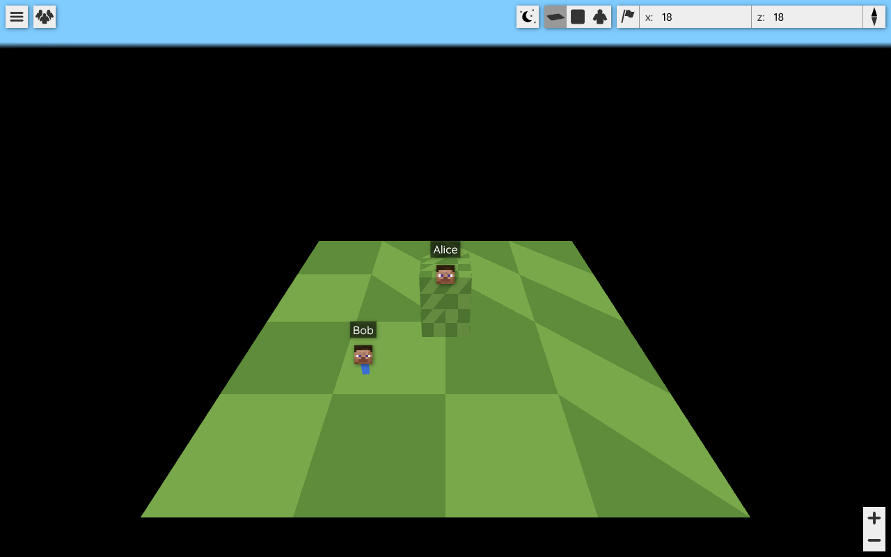
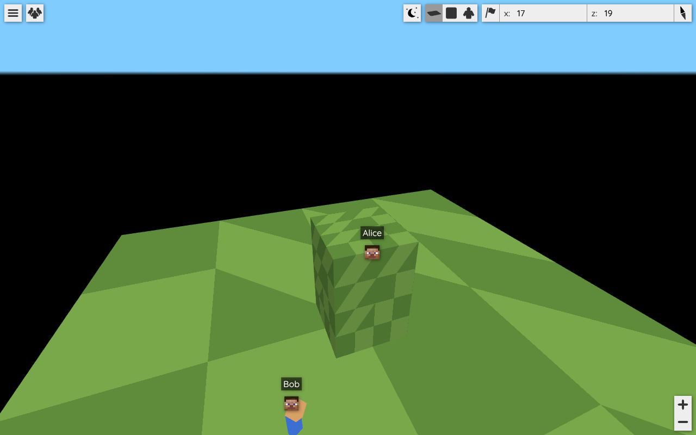

# BlueMap Live – Phase 2: Minimaler End-to-End-Prototyp

Stand: 2026-10-15 · Branch `bluemap-live` (Basis `mc1.21.1`, aufbauend auf Commit `9cb3d02` mit `analysis.md`)

> **Kurzfassung:** Der Datenfluss vom Fabric-Server bis zu einem **vorläufigen** 3D-Objekt in der originalen BlueMap-Marker-Szene ist implementiert.
> - **Getestet:** die plattformneutrale Server-Logik (JUnit, 17 Tests) und die Client-Logik (Node, 16 Tests).
> - **Im echten Browser geprüft:** der gebaute Original-Webclient (15 Schritte, 4/4 Läufe grün) und die pixelgleiche Kartendarstellung gegenüber dem unveränderten `mc1.21.1`-Webclient.
> - **Gebaut und getestet über GitHub Actions** (Nachtrag, siehe §1a): `./gradlew release` und `./gradlew spotlessCheck test` sind auf Commit `064ee35` erfolgreich, inklusive Fabric-Modul und JUnit-Tests. Lokal ist der Gradle-Build weiterhin nicht möglich (Netzwerk-Policy).
> - **Nicht** in einer echten Minecraft-Umgebung verifiziert; die manuellen Tests M1–M16 sind offen.
>
> Phase 2 ist damit **implementiert, gebaut und automatisiert getestet, aber nicht zur Laufzeit auf einem Minecraft-Server verifiziert**.

## 1a. Nachtrag: Verifikation über GitHub Actions (2026-10-15)

Der Workflow `.github/workflows/build.yml` (unverändert aus BlueMap übernommen) lief im Repository `Creepers1312/BlueMap-Live` auf Commit `064ee35` (Push und Pull Request):

| Job | Befehl | Ergebnis |
|---|---|---|
| Build | `./gradlew release --stacktrace` (Java 21, Temurin) | **erfolgreich** (Push-Lauf; PR-Lauf siehe GitHub) |
| Tests | `./gradlew spotlessCheck test --stacktrace` | **erfolgreich** (beide Läufe) |
| Deploy Docker Build | Push nach `ghcr.io/creepers1312/bluemap-live` | fehlgeschlagen: `denied: installation not allowed to Create organization package`; nicht codebezogen. Der Job läuft seit dem nachfolgenden CI-Commit nur noch im Original-Repository (`if: github.repository == 'BlueMap-Minecraft/BlueMap'`). |

Einschränkung: Die Job-Protokolle sind aus dieser Umgebung nicht abrufbar (Actions-Log-API über den Proxy gesperrt). Belegt ist das Job-Ergebnis, nicht die Anzahl der ausgeführten Tests. Der Gradle-Build mit Fabric/Loom bestätigt, dass `FabricMod`, `FabricPlayer` und die geänderten `common`-Klassen gegen Minecraft 1.21, Yarn `1.21+build.1` und Fabric API `0.100.1+1.21` kompilieren. Spotless bestätigt Format und Lizenz-Header.

---

## 1. Statusmatrix

| Funktion | Implementiert | Gebaut | Getestet | Verifiziert (Minecraft 1.21.1) |
|---|---|---|---|---|
| `PlayerMotionTracker` (Generation, Geschwindigkeit, Teleport-Erkennung) | ja | **ja** (`javac` lokal + Gradle, CI) | **ja**, JUnit 11 Tests (lokal; CI-Job `test` grün) | nein |
| `LivePlayersJson` (versioniertes Format) | ja | **ja** (`javac` lokal + Gradle, CI) | **ja**, JUnit 6 Tests + E2E | nein |
| `LivePlayerState`, `MovementState`, `Player#getLiveState()` | ja | **ja** (Gradle, CI) | indirekt | nein |
| `LivePlayersDataSupplier` / `MapRequestHandler` / `PluginConfig` / `Plugin` | ja | **ja** (Gradle, CI) | nein (keine eigenen Tests) | nein |
| `FabricPlayer` (Snapshot, Bewegungszustände, Body-Yaw) | ja | **ja** (Gradle/Loom, CI) | nein | nein |
| `FabricMod` (Sampling-Intervall, Respawn-/Weltwechsel-Events) | ja | **ja** (Gradle/Loom, CI) | nein | nein |
| Webclient: Parsing/Validierung (`LivePlayerData.js`) | ja | ja (`vite build`) | **ja**, 16 Node-Tests | – |
| Webclient: 3D-Platzhalter, Interpolation, Sprung, Entfernen | ja | ja | **ja**, Browser-E2E (Chromium) | nein |
| Regression Kartendarstellung | – | ja | **ja**, Pixelvergleich 0 Abweichungen (3/3) | nein |

„Verifiziert“ bedeutet hier ausdrücklich: im Zusammenspiel mit einem laufenden Minecraft-1.21.1-Fabric-Server geprüft. Das ist **für keine Funktion** erfolgt.

---

## 2. Geänderte und neue Dateien

**Server (common, plattformneutral)**

| Datei | Art | Inhalt |
|---|---|---|
| `common/.../common/live/LivePlayerState.java` | neu | unveränderlicher, konsistenter Spieler-Snapshot |
| `common/.../common/live/MovementState.java` | neu | Bewegungs-Flags |
| `common/.../common/live/PlayerMotionTracker.java` | neu | Generationszähler, Geschwindigkeit, Teleport-Erkennung |
| `common/.../common/live/LivePlayersJson.java` | neu | Writer für `live/players.json` (Protokoll 1) |
| `common/.../common/live/LivePlayersDataSupplier.java` | geändert | Filterlogik unverändert, Ausgabe über `LivePlayersJson`, angekündigtes Poll-Intervall |
| `common/.../common/serverinterface/Player.java` | geändert | neue Methode `getLiveState()` mit Default. Andere Plattformen (Paper, Spigot, Sponge, Forge, NeoForge) brauchen **keine** Änderung. |
| `common/.../common/config/PluginConfig.java` | geändert | `live-player-update-interval`, `live-player-extended-data` |
| `common/src/main/resources/.../config/plugin.conf` | geändert | Doku-Template der neuen Schlüssel |
| `common/.../common/web/MapRequestHandler.java` | geändert | HTTP-Cache von `players.json` folgt dem Intervall statt fest 1000 ms |
| `common/.../common/plugin/Plugin.java` | geändert | `savePlayerStates()` kündigt `write-players-interval` als Poll-Intervall an |
| `common/src/test/java/.../common/live/PlayerMotionTrackerTest.java` | neu | JUnit |
| `common/src/test/java/.../common/live/LivePlayersJsonTest.java` | neu | JUnit |

**Server (Fabric)**

| Datei | Art | Inhalt |
|---|---|---|
| `implementations/fabric/.../FabricPlayer.java` | geändert | alle Werte in einem `volatile` Snapshot; Bewegungszustände, Body-Yaw, `PlayerMotionTracker` |
| `implementations/fabric/.../FabricMod.java` | geändert | konfigurierbares Sampling, `ServerPlayerEvents.AFTER_RESPAWN`, `ServerEntityWorldChangeEvents.AFTER_PLAYER_CHANGE_WORLD` |

**Webclient**

| Datei | Art | Inhalt |
|---|---|---|
| `common/webapp/src/js/markers/LivePlayerData.js` | neu | Parsen/Validieren, Protokollbehandlung, Diskontinuitäts- und Veraltet-Erkennung (ohne three.js) |
| `common/webapp/src/js/markers/PlayerMarker.js` | geändert | 3D-Platzhalter als Kind des bestehenden Markers, lineare Interpolation, Sprung bei Diskontinuität |
| `common/webapp/src/js/markers/PlayerMarkerSet.js` | geändert | nutzt `parsePlayersResponse`, verwirft veraltete Antworten, merkt sich das Intervall |
| `common/webapp/src/js/markers/PlayerMarkerManager.js` | geändert | `updateInterval`-Getter |
| `common/webapp/src/js/BlueMapApp.js` | geändert (1 Zeile) | Poll-Intervall aus den Serverdaten statt fest 1000 ms |
| `common/webapp/package.json` | geändert | Skript `test` (Node-Testrunner, keine neuen Abhängigkeiten) |
| `common/webapp/test/LivePlayerData.test.mjs` | neu | Node-Unit-Tests |

**Dokumentation / Testwerkzeuge (nicht Teil des Builds):** `docs/bluemap-live/phase-2.md`, `docs/bluemap-live/e2e/*` (Testserver, Browser-Test, Regressionsvergleich, Screenshots).

**Nicht geändert:** Karten-Renderer (`MapViewer`, `Map`, `TileManager`, Shader), Navigation/Controls, `core`, Render-Pipeline, HTTP-Server.

---

## 3. Verifikation der Minecraft-/Fabric-APIs

Da Loom und Yarn nicht heruntergeladen werden konnten, wurden die Namen gegen die **Quelltexte auf GitHub** geprüft. Der Git-Zugriff funktioniert über den Proxy:

- **Fabric API `0.100.1+1.21`** (exakt die im Build verwendete Version, Tag `0.100.1+1.21`):
  - `ServerPlayerEvents.AFTER_RESPAWN` → `afterRespawn(ServerPlayerEntity oldPlayer, ServerPlayerEntity newPlayer, boolean alive)`
  - `ServerEntityWorldChangeEvents.AFTER_PLAYER_CHANGE_WORLD` → `afterChangeWorld(ServerPlayerEntity player, ServerWorld origin, ServerWorld destination)`
  - beide in `fabric-entity-events-v1` (1.6.12)
- **Yarn-Mappings, Branches `1.21` und `1.21.1`** (identisch für alle genutzten Namen):
  - `Entity`: `isSprinting()`, `isOnGround()`, `isSwimming()`, `isSneaking()`, `getBodyYaw()`, `getServer()`, `getPos()`, `getPitch()`, `getHeadYaw()`
  - `LivingEntity`: `isFallFlying()`
  - `PlayerEntity`: `getAbilities()`
  - `PlayerAbilities`: Feld `flying`
  - `ServerPlayerEntity`: `getServerWorld()`

Nicht durch Kompilierung geprüft sind die **Sichtbarkeit** (z. B. dass `PlayerAbilities.flying` `public` ist; laut Minecraft-Quelltext der Fall) und das **Laufzeitverhalten**. Das erledigt erst der Gradle-Build bzw. der Test auf einem echten Server.

Bewusst **nicht** verwendet: `Entity#getVelocity()`. Bei Spielern wird die Bewegung clientseitig berechnet, die Server-Velocity ist dafür nicht aussagekräftig. Die Geschwindigkeit wird deshalb aus aufeinanderfolgenden Positions-Samples abgeleitet. Mixins werden in Phase 2 nicht benötigt.

---

## 4. Erfassung und Aktualisierungsrate

| Aspekt | Umsetzung |
|---|---|
| Erfassungsort | Server-Thread, `ServerTickEvents.END_SERVER_TICK` → `FabricMod.updateSomePlayers()` (wie bisher), nur noch Spieler-Snapshots, kein Welt-Scan |
| Intervall | `live-player-update-interval` (Standard **250 ms**, begrenzt auf 50–10000) → `round(ms/50)` Ticks, Standard 5 Ticks |
| Verteilung | Pro Tick werden `ceil(spieler / intervallTicks)` Spieler aktualisiert, reihum. Jeder Spieler wird damit mindestens einmal pro Intervall erfasst, die Last verteilt sich auf die Ticks. |
| Sofort-Updates | Respawn und Weltwechsel (Fabric-Events) → sofortiges `update()` + Diskontinuitätsmarke |
| Fallback | Ist die Konfiguration noch nicht geladen, gelten 20 Ticks (das bisherige Verhalten) |
| Warteschlangen | Keine. Pro Spieler gibt es genau einen aktuellen Snapshot (`volatile`), der beim nächsten Sample ersetzt wird. Der Speicher wächst nur mit der Spielerzahl. |
| Thread-Sicherheit | Alle Werte eines Samples stecken in einem unveränderlichen Objekt. Der Webserver-Thread sieht dadurch nie eine neue Generation mit alter Position (oder umgekehrt). |
| Übertragung | `GET maps/<id>/live/players.json`. Der Server erzeugt die Antwort höchstens einmal pro Intervall (`CachedRateLimitDataSupplier`) und liefert sie allen Clients. Der Client pollt im angekündigten Intervall (`updateInterval`). |

**Trennung von Erfassung und Übertragung:** Beide laufen getrennt (Tick-Sampling bzw. HTTP-Cache und Client-Polling), verwenden aber bewusst denselben Konfigurationswert. Häufiger zu übertragen als zu erfassen liefert identische Daten; häufiger zu erfassen als zu übertragen ist verschwendete Arbeit. Eine eigene Einstellung ist erst sinnvoll, wenn ein Push-Kanal existiert.

**Was wird wann übertragen?** In Phase 2 enthält jede Antwort den **vollständigen** Zustand aller sichtbaren Spieler. Das ist absichtlich so gewählt: Ein Delta-Format bräuchte Sequenzen und Neusynchronisation; bei vollem Zustand ist ein verlorenes Poll-Ergebnis folgenlos. Ein Spieler kostet etwa 450 Byte JSON.

| Ändert sich typischerweise … | Felder |
|---|---|
| jedes Intervall | `position`, `rotation`, `bodyYaw`, `velocity`, `time` |
| nur bei Zustandswechsel | `state.*`, `world`, `foreign`, `generation`, `name` |

Diese werden derzeit trotzdem jedes Mal mitgesendet. Eine Optimierung auf „nur bei Änderung“ ist für Phase 5 vorgesehen, falls Messungen sie rechtfertigen.

---

## 5. Teleport- und Zustandswechsel-Erkennung

Pro Spieler verwaltet der `PlayerMotionTracker` einen **Generationszähler**. Er wird erhöht, wenn zwischen zwei Samples gilt:

1. **Welt/Dimension geändert** (Vergleich des Dimensions-Keys),
2. **explizite Diskontinuität** gemeldet: Respawn (`AFTER_RESPAWN`) oder Weltwechsel (`AFTER_PLAYER_CHANGE_WORLD`); auch ein Respawn direkt neben dem Todesort zählt,
3. **Positionssprung:** Strecke ≥ 8 Blöcke **und** Geschwindigkeit > 100 Blöcke/s (Zeitabstand mindestens 50 ms). Damit werden `/tp`, Enderperlen über größere Distanz und Plugin-Teleports erfasst. Elytra mit Raketen (ca. 30–35 Blöcke/s) gilt dagegen nicht als Teleport.

Bei einem Generationswechsel wird die Geschwindigkeit auf 0 gesetzt.

Der Client springt (statt zu interpolieren), wenn die Generation, die Welt oder `foreign` sich ändert, beim ersten Update, oder wenn die Strecke > 64 Blöcke ist. Letzteres ist die Absicherung für Server ohne Generationszähler (ältere Server, andere Plattformen).

**Bekannte Lücke:** Ein kurzer Teleport (< 8 Blöcke) ohne Event wird über ≤ 1 Intervall (250 ms) interpoliert. Das ist sichtbar harmlos. Eine exakte Erkennung wäre über einen Mixin auf `ServerPlayNetworkHandler#requestTeleport` möglich; in Phase 2 wurde darauf verzichtet (keine Mixin-Infrastruktur, nicht baubar).

---

## 6. Datenformat `live/players.json` (Protokoll 1)

```json
{
  "protocol": 1,
  "serverTime": 1792075400701,
  "updateInterval": 250,
  "players": [{
    "uuid": "069a79f4-44e9-4726-a5be-fca90e38aaf5",
    "name": "Notch",
    "foreign": false,
    "position": {"x": 10.5, "y": 64.0, "z": -20.25},
    "rotation": {"pitch": 15.0, "yaw": 90.0, "roll": 0.0},
    "world": "minecraft:overworld",
    "generation": 3,
    "time": 1792075400650,
    "bodyYaw": 80.0,
    "velocity": {"x": 4.3, "y": 0.0, "z": 0.0},
    "state": {"sneaking": false, "sprinting": true, "onGround": true,
              "swimming": false, "flying": false, "fallFlying": false}
  }]
}
```

- **Kompatibilität:** `players[].uuid, name, foreign, position, rotation` sind unverändert in Name und Bedeutung. Der **unveränderte Original-Webclient** funktioniert mit dem neuen Format; das ist im Browser geprüft (Kopfmarker an korrekter Position, keine Fehler). Mit `live-player-extended-data: false` sendet der Server pro Spieler nur die Originalfelder.
- **Konventionen:** Rotation in Grad nach Minecraft-Konvention: Yaw 0 = Blick nach +Z (Süden), 90 = −X (Westen), positiver Pitch = Blick nach unten. `rotation.yaw` ist die **Kopf**-Rotation (wie bisher), `bodyYaw` die Körperrotation. `position` = Füße. `velocity` in Blöcken pro Sekunde. Zeiten in Epoch-Millisekunden (Serveruhr).
- **Versionierung:** `protocol` wird nur bei **inkompatiblen** Änderungen erhöht. Neue optionale Felder ändern die Version nicht.

| Fall | Definiertes Verhalten (Client, `LivePlayerData.js`) |
|---|---|
| `protocol` fehlt | älterer Server (Protokoll 0): nur Originalfelder; Teleport-Erkennung nur über Distanz > 64 |
| `protocol` > unterstützt | wie Protokoll 0, also nur die garantiert stabilen Originalfelder |
| Antwort ist kein Objekt / `players` kein Array | ungültig → alle Spieler werden entfernt (bisheriges Verhalten bei Fehlern) |
| Eintrag ohne `uuid` oder ohne gültige, endliche Position | Eintrag wird verworfen und gezählt (Meldung auf Debug-Level), andere Einträge werden verarbeitet |
| optionale Felder fehlen oder haben falschen Typ | Defaults: Rotation 0, `bodyYaw` = Kopf-Yaw, `generation`, `time`, `velocity`, `state`, `world` = `null`; `foreign` nur bei `true`; Name fällt auf die UUID zurück |
| `serverTime` kleiner als zuletzt verarbeitet | ganze Antwort wird ignoriert (Cache/Proxy) |
| `time` eines Spielers kleiner als sein letzter Stand | Positionsupdate dieses Spielers wird ignoriert |
| Spieler fehlt in der Antwort (Disconnect, gefiltert) | Marker inkl. 3D-Objekt wird entfernt |
| Live-Endpunkt nicht erreichbar | alle Spieler werden entfernt (keine Geisterspieler), erneuter Versuch nach max(Intervall, 15 s) (bestehendes Verhalten von `MarkerManager`); Karte bleibt voll funktionsfähig |
| Dimensionswechsel | `foreign: true` → Marker unsichtbar; bei Rückkehr Sprung, keine Interpolation |
| `updateInterval` fehlt oder ist ungültig | 1000 ms; sonst begrenzt auf 100–10000 ms |

**Server-seitig:** Nicht-endliche Zahlen (NaN/∞) werden als 0 geschrieben. Ein nicht-lenienter `JsonWriter` würde sonst die ganze Antwort abbrechen.

---

## 7. Änderungen am Webclient

- `PlayerMarker` (weiterhin ein `Marker` im bestehenden `PlayerMarkerSet` in `mapViewer.markers`) bekommt ein Kind-`Group` „bm-player-placeholder-model“. Es besteht aus einer Körper-Box, einer Kopf-Box an einem Hals-Pivot und einer dunklen „Gesichts“-Box zur Richtungsanzeige.
  - **Rendering:** Die Marker-Szene wird von `MapViewer.render()` mit derselben Kamera und **ohne vorheriges Leeren des Tiefenpuffers** gezeichnet. Das Modell wird deshalb korrekt von der Kartengeometrie verdeckt (Screenshot 2).
  - **Ressourcen:** Geometrien und Materialien (`MeshBasicMaterial`) werden **einmal** erzeugt und von allen Spielern geteilt. Pro Spieler entstehen nur drei `Mesh`-Objekte; beim Entfernen wird nichts Geteiltes freigegeben.
  - **Klicks:** Die Meshes ignorieren Raycasts, damit das Modell Klicks auf die Karte nicht abfängt.
  - **Sichtbarkeit:** Ab einer Kameradistanz von 1000 wird nur der bisherige Kopf-/Namensmarker angezeigt.
- Der bestehende **CSS-Kopf- und Namensmarker bleibt unverändert**, ebenso `marker.position` (Kopfhöhe). Dadurch funktionieren „Spieler folgen“ und die Spielerliste unverändert.
- **Interpolation:** linear vom aktuell angezeigten Zustand zum neuen Ziel über `min(Sample-Abstand, Poll-Intervall)`. Eine laufende Animation wird bei neuen Daten abgebrochen; das alte `animate()` überlappte bei jedem Update. Winkel laufen über den kürzesten Weg.
- **Rotation:** Körper `rotation.y = −bodyYaw`; Kopf relativ zum Körper `y = −(headYaw − bodyYaw)`, `x = pitch` (Reihenfolge YXZ).
- **Bekannte Einschränkung:** Ohne Benutzerinteraktion rendert der `MapViewer` nur mit etwa 20 fps (bestehendes Energiesparverhalten). Phase 2 ändert das nicht. Flüssigere Animation (`redraw()` während sichtbarer Bewegung) ist für Phase 3 vorgesehen.


*Screenshot 2 – Alice steht hinter der Säule: Ihr 3D-Platzhalter wird von der Hires-Geometrie verdeckt, nur der (wie bisher immer sichtbare) CSS-Kopf- und Namensmarker liegt darüber. Bob steht davor.*


*Screenshot 4 – Nahaufnahme: Bobs Platzhalter mit Körper-Yaw −30°, Kopf-Yaw −60°, Pitch 35°. Die Testkarte wurde mit BlueMaps `PRBMWriter` erzeugt und vom originalen Hires-Shader dargestellt.*

---

## 8. Ausgeführte Befehle und Ergebnisse

| Befehl | Ergebnis |
|---|---|
| `curl` auf `maven.fabricmc.net`, `libraries.minecraft.net`, `piston-meta.mojang.com`, `repo.bluecolored.de` | weiterhin vom Proxy abgewiesen (HTTP 000/403) |
| `./gradlew …` | **nicht erneut ausgeführt**, scheitert an denselben Hosts (siehe `analysis.md` §10) |
| `git clone` FabricMC/fabric @ `0.100.1+1.21`, FabricMC/yarn @ `1.21` und `1.21.1` | ok, API-Namen geprüft (Abschnitt 3) |
| `javac --release 21 -Xlint:all` für `MovementState`, `LivePlayerState`, `PlayerMotionTracker`, `LivePlayersJson` + Tests (Klassenpfad: flow-math 1.0.3, gson 2.8.9, annotations 23.0.0, junit-platform-console-standalone 1.8.2; SHA-1 gegen Maven Central geprüft) | ok, keine Warnungen |
| JUnit Console Launcher, Paket `de.bluecolored.bluemap.common.live` | **17/17 bestanden** |
| `npm test` (`common/webapp`) | **16/16 bestanden** |
| `npx eslint --no-fix` auf alle geänderten/neuen JS-Dateien | ok, keine Befunde |
| `npm run build` (`common/webapp`) | ok, nur die bekannte Chunk-Size-Warnung (wie Baseline) |
| `javac … LiveE2EServer.java` gegen `core/` und `common/` | ok |
| `node docs/bluemap-live/e2e/player-e2e.mjs` (Chromium 1194, SwiftShader) | finale Version: **15/15 Schritte, 4 von 4 Läufen** |
| `node docs/bluemap-live/e2e/regression-e2e.mjs` (Original `mc1.21.1` vs. `bluemap-live`, ohne Spieler) | **0 abweichende Pixel**, 3 von 3 Läufen |
| Original-Webclient (`mc1.21.1`) gegen neues Datenformat mit Spieler | Kopfmarker an korrekter Position, keine Seitenfehler |

Hinweise zur Ehrlichkeit der E2E-Ergebnisse:

- Frühere Versionen des **Testskripts** waren instabil. Ursachen waren Timing unter Software-Rendering, das Setzen der Kamera über `controlsManager.distance` (verhindert Hires-Laden, beim Original identisch) und ein Fehler im Testserver, durch den der Veraltet-Test nichts prüfte. Diese Punkte wurden im Testwerkzeug behoben.
- Der Testlauf hat außerdem einen **echten Fehler** im Client gefunden: Die Interpolation dauerte nach Pausen zu lange. Behoben wurde er in `interpolationDuration()`, mit zusätzlichem Unit-Test.

Inhalt des Browser-E2E (`player-e2e.mjs`):

1. Karte und Hires-Tile des Original-Webclients geladen
2. Beitritt: Marker mit 3D-Platzhalter in `mapViewer.markers`, CSS-Kopfmarker vorhanden
3. Bewegung wird interpoliert (Zwischenpositionen beobachtet)
4. Drehen ohne Bewegung: Yaw/Pitch übernommen, Position unverändert
5. Kopf-Yaw ≠ Körper-Yaw: nur der Kopf dreht sich relativ
6. Teleport (1000 Blöcke): Sprung ohne Zwischenpositionen, Generation +1
7. Zwei Spieler, einer hinter Kartengeometrie (Screenshot)
8. Dimensionswechsel: unsichtbar, bei Rückkehr Sprung
9. Respawn in der Nähe: Generation +1, keine Interpolation
10. Veraltete Antwort (älteres `serverTime`, ältere Position) wird ignoriert; der Server bestätigt die Auslieferung
11. Disconnect entfernt Marker und Modell (nur das Modell des anderen Spielers bleibt in der Szene)
12. Spieler-Updates lösen **keine** Tile-Ladevorgänge aus
13. Live-Endpunkt nicht erreichbar: Spieler entfernt, Karte geladen; nach Wiederherstellung kehren die Spieler zurück
14. Nahaufnahme (Screenshot)
15. keine unbehandelten Fehler in der Seite

---

## 9. Nicht ausgeführte Tests

| Test | Grund |
|---|---|
| Lokaler Gradle-Build in dieser Umgebung | Netzwerk-Policy blockiert die Abhängigkeits-Repositories. **Ersetzt durch GitHub Actions** (§1a): `release` und `spotlessCheck test` grün. |
| Echte HTTP-Kette `MapRequestHandler` → `CachedRateLimitDataSupplier` → `JsonDataRequestHandler` | nicht baubar; im E2E durch `LiveE2EServer` ersetzt |
| Alle Laufzeittests mit Minecraft 1.21.1 + Fabric (Abschnitt 10, M1–M16) | **offen.** Fehlende Voraussetzungen: (1) Minecraft-1.21.1-Server-Jar und Libraries (`piston-meta.mojang.com`, `libraries.minecraft.net` gesperrt); (2) Fabric Loader/Installer und Fabric API (`maven.fabricmc.net` gesperrt); (3) zwei Minecraft-Java-Accounts mit Vanilla-Client 1.21.1 für Beitritt, Bewegung, Teleport, Portal, Respawn – ein Client lässt sich in dieser Umgebung nicht bedienen; (4) für Skins: Zugriff auf `sessionserver.mojang.com`. Der `release`-Jar aus dem CI-Artefakt („artifacts“, Build-Job) kann für den Test direkt verwendet werden. |
| Performance-Messungen (Server-Tick-Zeit, Netzwerkvolumen) | erst mit lauffähigem Server sinnvoll |

---

## 10. Manueller Integrationstest (Minecraft 1.21.1, Fabric, Vanilla-Client)

**Aufbau**

1. `./gradlew :fabric:release` auf einem Rechner mit Netzzugang; das Jar liegt unter `build/release/bluemap-<version>-fabric.jar`.
2. Fabric-Server 1.21.1 mit Fabric Loader ≥ 0.17.2 und Fabric API für 1.21.1; das BlueMap-Jar nach `mods/`.
3. Server starten, in `config/bluemap/core.conf` `accept-download: true` setzen, `/bluemap reload`, Overworld rendern lassen.
4. `config/bluemap/plugin.conf`: Standardwerte (`live-player-update-interval: 250`, `live-player-extended-data: true`).
5. Normaler Minecraft-1.21.1-Client **ohne** Mods; zwei Accounts für Mehrspielertests. Browser auf `http://<server>:8100`.

**Ablauf und erwartete Ergebnisse** (Status „offen“ = noch nicht ausgeführt)

| # | Aktion | Erwartung | Status |
|---|---|---|---|
| M1 | Spieler A verbindet sich | innerhalb von ≈0,5 s Kopfmarker + 3D-Platzhalter an der Spielerposition | offen |
| M2 | A läuft, sprintet, schleicht, springt | Platzhalter folgt flüssig (≈250 ms Verzögerung); `players.json` zeigt `state.sprinting/sneaking/onGround` passend | offen |
| M3 | A dreht sich auf der Stelle, schaut hoch/runter | Kopf dreht sich, Körper folgt verzögert (`bodyYaw`), Position konstant | offen |
| M4 | `/tp A ~1000 ~ ~` | Platzhalter springt, kein Flug über die Karte; `generation` +1 | offen |
| M5 | Enderperle (> 8 Blöcke) | Sprung (Geschwindigkeit > 100 Blöcke/s) | offen |
| M6 | A stirbt und respawnt | Sprung zum Spawn; `generation` +1 | offen |
| M7 | A betritt Nether-Portal | Marker auf der Overworld-Karte verschwindet; auf der Nether-Karte erscheint er (Sprung) | offen |
| M8 | A trennt die Verbindung | Marker und Modell verschwinden beim nächsten Poll | offen |
| M9 | A verbindet sich erneut | neuer Marker an neuer Position, kein Flug von der alten Position | offen |
| M10 | A und B bewegen sich gleichzeitig | beide unabhängig korrekt | offen |
| M11 | Elytra-Flug mit Raketen | wird interpoliert, **kein** Teleport-Sprung | offen |
| M12 | Karte: Texturen, Zoom, Drehen, Flat-/Free-Flight-Ansicht, Marker-Sets, „Spieler folgen“ | unverändert | offen |
| M13 | `live-player-markers: false`, `/bluemap reload` | keine Spieler; Karte normal | offen |
| M14 | `live-player-extended-data: false` | `players.json` enthält nur Originalfelder; Platzhalter funktioniert, Teleport-Erkennung nur per Distanz | offen |
| M15 | Integrierten Webserver deaktivieren bzw. Endpunkt blockieren | Karte über externen Webserver weiter nutzbar, keine Spieler, keine Fehlerschleife | offen |
| M16 | Server-Tick-Zeit (`/tick query` bzw. Spark) mit 1 / 20 Spielern, Intervall 250 vs. 1000 ms | kein messbarer Mehraufwand gegenüber Baseline (zu dokumentieren) | offen |

---

## 11. Verbleibende technische Einschränkungen

1. **Nicht gebaut:** Java- und Fabric-Code sind nur gegen Quelltext und Mappings geprüft, nicht kompiliert. Tippfehler oder Sichtbarkeitsprobleme wären erst beim Gradle-Build sichtbar.
2. **Platzhalter statt Spielermodell:** Es gibt keinen Skin, keine Gliedmaßen und keine Animation. Das ist ausdrücklich kein fertiges Spielermodell (Phase 3).
3. **Teleports < 8 Blöcke ohne Event** werden kurz interpoliert (Abschnitt 5).
4. **Body-Yaw** stammt aus der serverseitigen Berechnung (`LivingEntity.bodyYaw`). Ob sie für Spieler auf dem Server genauso nachgeführt wird wie im Client, ist **nicht verifiziert**.
5. **20-fps-Render-Drosselung** des `MapViewer` im Leerlauf; die Bewegung wirkt dadurch weniger flüssig als möglich.
6. **Andere Plattformen** (Paper, Spigot, Sponge, Forge, NeoForge) liefern weiterhin 1 Sample pro Sekunde, ohne Generation und Bewegungszustände. Ihre Antworten sind gültig (Default von `getLiveState()`), aber der Client erkennt Teleports dort nur über die Distanz.
7. **Datenschutz:** Mit Standardkonfiguration sind Bewegungen genauer verfolgbar (250 ms, Zustände, Dimension). Abschaltbar über `live-player-extended-data: false` bzw. ein größeres Intervall. Die Frage nach dem Standardwert aus `analysis.md` ist weiterhin offen.
8. **Volle Zustandsübertragung** bei jedem Poll; bei sehr vielen Spielern und Clients ist das noch nicht gemessen.
9. Der Platzhalter ist **nicht abschaltbar**, solange Spielermarker aktiv sind; die vorhandene Marker-Set-Umschaltung „Spieler“ blendet ihn aber zusammen mit den Köpfen aus. Eine eigene Option ist für Phase 3 vorgesehen (zusammen mit dem echten Modell).

---

## 12. Nächster sinnvoller Schritt

1. **Gradle-Build ermöglichen:** Netzwerkfreigabe der vier Hosts oder lokaler Build, dann `./gradlew spotlessCheck :common:test :fabric:build`. Danach den manuellen Test M1–M16 auf einem echten 1.21.1-Fabric-Server durchführen und die Ergebnisse hier eintragen. **Erst danach gilt Phase 2 als abgeschlossen.**
2. Anschließend Phase 3: echtes Spielermodell.
   - Skin-Speicherung `assets/playerskins/<uuid>.png` + Modelltyp classic/slim in `PlayerSkinUpdater`/`MojangSkinProvider`
   - geteilte UV-gemappte Geometrie mit Overlay-Layer
   - Material mit der Lichtformel der Karte
   - Gliedmaßen-Pivots, Geh-/Sprint-/Schleich-Animation aus `velocity` und `state`
   - `redraw()` während sichtbarer Bewegung
   - Konfigurationsoption für Modell vs. nur Kopf
