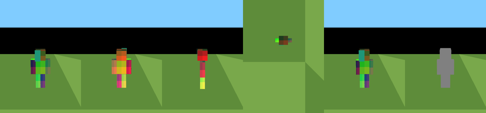

# BlueMap Live – Phase 3, Schritte 2 und 3: vollständige Skins und 3D-Modellgeometrie

Stand: 2026-10-15 · Branch `bluemap-live` · Plan: `phase-3-plan.md`

> **Kurzfassung:** Implementiert sind vollständige Spieler-Skins auf dem Server (64×64, Konvertierung alter 64×32-Skins, Classic/Slim, `skin-download`) und ein echtes 3D-Spielermodell mit sechs getrennten Körperteilen, korrektem Skin-UV-Mapping und zweiter Skin-Schicht im originalen Webclient.
> - **Getestet:** Server über GitHub Actions (`spotlessCheck test`, `release` grün auf `ddea9cf`) und lokal (35 Java-Tests ohne Gradle); Webclient mit 30 Node-Tests und einem Browser-Screenshot-Test (22/22 Schritte, 3/3 Läufe).
> - **Pixelgleich:** Die Kartendarstellung ohne Spieler ist gegenüber dem Original weiterhin pixelgleich.
> - **Noch offen:** Nicht verifiziert sind echte Mojang-Skins und der Betrieb auf einem Minecraft-1.21.1-Server.
>
> **Nachtrag (Schritt 4, §7):** Der Dimensionswechsel zeigt das Modell jetzt ohne Neuladen der Seite. Dazu kommen Animationen für Idle, Gehen, Sprinten, Schleichen, Schlag (Armschwung), Springen/Fallen sowie vereinfacht Schwimmen, Gleiten und Fliegen. Der Armschwung beruht auf einem Server-Ereignis. Automatisch getestet ist das mit JUnit, Node und Browser-E2E; in Minecraft ist es **nicht** geprüft.

---

## 1. Statusmatrix

| Funktion | Implementiert | Gebaut | Getestet | Visuell geprüft | Verifiziert (Minecraft 1.21.1) |
|---|---|---|---|---|---|
| Vollständiger Skin → `assets/playerskins/<uuid>.png` (+ `.json`) | ja | ja (CI) | ja (JUnit, CI) | – | nein |
| 64×32 → 64×64 (wie Minecraft) | ja | ja | ja (JUnit, pixelgenau) | – | nein |
| Classic/Slim aus Mojang-Profil, Heuristik für fremde Provider | ja | ja | ja (JUnit, Beispiel-JSONs ohne Netz) | – | nein (kein Zugriff auf `sessionserver.mojang.com`) |
| `skin-download` wird ausgewertet | ja | ja | ja (JUnit) | – | nein |
| Cache (max. 1 Download/h/Spieler), Fehler, Timeouts | ja | ja | ja (JUnit; Timeouts nur im Code, nicht gegen echte Netzfehler) | – | nein |
| `players.json`: `skin {model, version}` | ja | ja | ja (JUnit + Node + E2E) | – | nein |
| Modellgeometrie, 6 Körperteile, Gelenke | ja | ja (`vite build`) | ja (Node) | ja (Screenshot-Pixel) | nein |
| UV-Zuordnung aller Flächen, Orientierung | ja | ja | ja (Node, farbcodierter Skin) | ja (Vorder-, Rück-, Seiten-, Draufsicht) | nein |
| Zweite Skin-Schicht (Hut, Jacke, Ärmel, Hose) | ja | ja | ja (Node: UV + Aufmaß) | teilweise (nur Hut-Vorderseite) | nein |
| Classic- vs. Slim-Arme | ja | ja | ja (Node) | ja (3-px-Arm im Screenshot) | nein |
| Geometrie-/Texturteilung, Freigabe | ja | ja | ja (Node + E2E) | – | – |
| Standard-Skin aus `textures.json` | ja | ja | ja (Node + E2E mit synthetischer Textur) | ja | **nein**: mit einem echten Resource-Pack nicht geprüft |
| Modell nach Dimensionswechsel/Kartenwechsel ohne Neuladen (§7.1) | ja | ja (`vite build`) | ja (Browser-E2E) | – | **nein** (der Fehler wurde in Minecraft beobachtet, der Fix ist dort nicht geprüft) |
| Skin für Spieler, die vor dem Laden von BlueMap beigetreten sind (§7.1) | ja | **nein** (lokal kein Gradle, CI nicht gelaufen) | nein (nur Code-Review) | – | nein |
| Armschwung-Ereignis vom Server `swing {count, arm}` (§7.2) | ja | `common` lokal (javac), **Fabric nicht** | ja (JUnit) | – | nein |
| Animationen Idle, Gehen, Sprinten, Schleichen, Schlag (§7.3) | ja | ja (`vite build`) | ja (Node + Browser-E2E) | nein (Knochenwinkel geprüft, kein Pixelvergleich) | nein |
| Springen/Fallen, Schwimmen, Gleiten, Fliegen (Näherungen, §7.3) | ja | ja | ja (Node + Browser-E2E für Springen) | nein | nein |

„Visuell geprüft“ heißt hier: im gebauten Original-Webclient in Chromium (SwiftShader) gerendert, Pixelfarben im Screenshot automatisch mit dem farbcodierten Test-Skin verglichen.

---

## 2. Schritt 1 – geprüfte Ausgangslage

| Thema | Befund (Code) |
|---|---|
| Skin-Download | `PlayerSkinUpdater.updateSkin`: `SkinProvider.load(uuid)` (API, Submodul `api` @ `ba63193`) → nur Kopf-Icon `playerheads/<uuid>.png` in jede Map-Storage |
| Skin-Cache | nur eine In-Memory-Drossel `skinUpdates` (1 Download/h/Spieler), keine Skin-Dateien außer Kopf-Icons |
| Mojang-Profil | `MojangSkinProvider`: `sessionserver.mojang.com/.../profile/<uuid>` → `textures.SKIN.url`; Modell wurde **nicht** gelesen; **keine Timeouts** (`URL.openStream`, `ImageIO.read(URL)`) |
| `skin-download` | `PluginConfig.skinDownload` existiert, wurde aber **nirgends** ausgewertet → bestätigt, jetzt umgesetzt |
| `assets/playerskins/` | existierte nicht (nur im Plan) → neu angelegt, analog zu `playerheads/` über `MapStorage.asset(name)` |
| Standard-Skin | `player_head.json` referenziert `entity/player/slim/steve`. `ResourcePack.collectUsedTextureKeys()` lädt alle von Modellen genutzten Texturen; `BmMap` schreibt sie als PNG-Data-URL mit `resourcePath` in `textures.json` |
| Webclient-Texturen | Hires: eigene `Texture` + `ShaderMaterial` je Eintrag in `textures.json` (`Map.createHiresMaterial`); Renderer ohne `outputEncoding`-Konfiguration (linear) → Skin-Texturen brauchen keine Farbraumkonvertierung |
| `bluemapRenderFrame` | wird vor jedem gerenderten Frame dispatcht (für die Animation in Schritt 4 vorgesehen, hier noch nicht genutzt) |
| Spieler-Marker-Szene | `mapViewer.markers` → `PlayerMarkerSet` → `PlayerMarker` (Phase 2) |

---

## 3. Server: vollständige Skins

**Dateien:**
- `common/.../plugin/skins/PlayerSkinUpdater.java` (geändert)
- `MojangSkinProvider.java` (geändert)
- neu: `SkinUtil.java`, `SkinInfo.java`, `SkinModel.java`
- `live/LivePlayersJson.java`, `live/LivePlayersDataSupplier.java`, `web/MapRequestHandler.java`, `plugin/Plugin.java`
- `plugin.conf` (Kommentar)

**Gespeicherte Dateien pro Map-Storage**

| Asset | Inhalt | kompatibel? |
|---|---|---|
| `playerheads/<uuid>.png` | Kopf-Icon (48×48), unverändert über `PlayerIconFactory` | ja, unverändert |
| `playerskins/<uuid>.png` | vollständiger Skin, auf 64×64 normalisiert (ARGB) | neu |
| `playerskins/<uuid>.json` | `{"model":"classic"\|"slim","version":"<16 hex>"}` | neu; markiert den Skin als vorhanden; wird nach dem Bild geschrieben |

**Verhalten**

- **64×64:** pixelgleiche Kopie.
- **64×32 (Legacy):** Bestehende Pixel bleiben an ihrem Platz. Linker Arm und linkes Bein entstehen als horizontal gespiegelte Kopien von rechtem Arm und rechtem Bein (12 Regionen). Alle Bereiche der zweiten Schicht, die es im alten Format nicht gab, bleiben **transparent**, es wird also keine zweite Schicht erfunden.
  - Wie in Minecraft wird ein **vollständig deckender** Hut-Bereich eines Legacy-Skins als ungenutzt behandelt (transparent), weil viele alte Skins dort Vollfarbe hatten.
  - Die Kopier-Tabelle stimmt mit `skinview-utils` 0.7.1 (`convertSkinTo1_8`) und mit der Vanilla-Konvertierung überein, soweit bekannt **[Referenz; Vanilla-Quelle nicht einsehbar]**.
- **Andere Größen** (z. B. HD-Skins fremder Provider): Nur das Kopf-Icon wird geschrieben. Das Modell zeigt dann den Standard-Skin.
- **Modell:**
  - `MojangSkinProvider` liest `textures.SKIN.metadata.model`. Mojang setzt `"slim"` nur für Slim-Skins; fehlt das Feld, ist der Skin **classic** (stabiler Fallback, auch bei unbekannten Werten).
  - Fremde `SkinProvider` (API) liefern nur ein Bild. Dafür gibt es eine dokumentierte Heuristik (`SkinUtil.inferModel`): slim, wenn eine der vier nur von Classic genutzten Regionen Transparenz enthält oder alle schwarz bzw. weiß sind, sonst classic.
  - Die API bleibt unverändert.
- **Version:** SHA-256 über die normalisierten Pixel, gekürzt auf 16 Hex-Zeichen. Sie dient als Cache-Busting-Parameter, weil Assets mit `max-age=86400` ausgeliefert werden.
- **Cache:** Es bleibt bei der bestehenden Drossel von 1 Download pro Stunde und Spieler, auch bei Fehlschlag. Fehlt die Skin-Info im Speicher (Neustart, `/bluemap reload`, Spieler bereits online), wird sie beim ersten Abruf **asynchron aus der Storage** gelesen, ohne Netzwerk.
- **Fehler:**
  - Fehlendes Profil, Profil ohne Skin, ungültiges JSON, kein Bild, IO-Fehler oder Timeout führen zu keinem Skin. Es wird nur ein Debug-Log geschrieben; `onPlayerJoin` fängt alles ab.
  - Neu: **10-s-Connect- und Read-Timeout** für Profil und Bild. Vorher konnte ein hängender Download einen Thread im BlueMap-Thread-Pool unbegrenzt blockieren.
  - Ein Schreibfehler in einer Map-Storage betrifft nur diese Map.
- **`skin-download: false`:** Es finden **keine** Netzwerkzugriffe statt (getestet: Provider wird nie aufgerufen). Bereits gespeicherte Skins (`playerskins/*.png` + `.json`) bleiben erhalten und werden weiter verwendet. Spieler ohne gespeicherten Skin erscheinen mit dem Standard-Skin.
- **`players.json`:** optionales Feld `skin: {model, version}`, nur bei bekanntem Skin und `live-player-extended-data: true`. Die Protokollversion bleibt 1. Der unveränderte Original-Webclient ignoriert das Feld; das ist im Browser geprüft.

---

## 4. Webclient: Modellgeometrie und UV-Zuordnung

**Dateien:**
- neu: `markers/player/PlayerModelLayout.js` (reine Daten und Mathematik), `PlayerModelGeometry.js`, `PlayerSkinCache.js`, `PlayerModel.js`
- geändert: `PlayerMarker.js` (Platzhalter ersetzt), `PlayerMarkerSet.js`, `PlayerMarkerManager.js`, `LivePlayerData.js`, `BlueMapApp.js` (Skin- und Textur-URL übergeben)
- **unverändert:** `MapViewer`, `Map`, Tiles, Shader, Controls

### 4.1 Geometrie (Einheit: Skin-Pixel, y oben, Modell blickt nach +z, rechte Spielerseite = −x, Füße bei y = 0)

| Teil | Box B×H×T | Gelenk (Pivot) | Box-Mitte rel. Pivot | UV | UV 2. Schicht | Aufmaß 2. Schicht |
|---|---|---|---|---|---|---|
| Kopf | 8×8×8 | (0, 24, 0) Hals | (0, 4, 0) | 0,0 | 32,0 | 0,5 |
| Rumpf | 8×12×4 | (0, 24, 0) | (0, −6, 0) | 16,16 | 16,32 | 0,25 |
| rechter Arm | 4×12×4 / slim 3×12×4 | (−5, 22, 0) / slim (−5, 21,5, 0) | (−1, −4, 0) / slim (−0,5, −4, 0) | 40,16 | 40,32 | 0,25 |
| linker Arm | 4×12×4 / slim 3×12×4 | (5, 22, 0) / slim (5, 21,5, 0) | (1, −4, 0) / slim (0,5, −4, 0) | 32,48 | 48,48 | 0,25 |
| rechtes Bein | 4×12×4 | (−1,9, 12, 0) | (0, −6, 0) | 0,16 | 0,32 | 0,25 |
| linkes Bein | 4×12×4 | (1,9, 12, 0) | (0, −6, 0) | 16,48 | 0,48 | 0,25 |

- **Maßstab:** 0,9375/16 Block pro Pixel, Gesamthöhe 32 px = 1,875 Blöcke. Die Arme liegen in beiden Varianten bündig am Rumpf (Innenkante x = ±4); nur die Außenkante wandert (Classic ±8, Slim ±7).
- **Abweichung vom Plan:** Slim-Schultergelenk 0,5 px tiefer, wie im Vanilla-`PlayerEntityModel` (`pivot y 2.5` statt `2`) **[Referenz; aus Kenntnis des Vanilla-Codes, hier nicht einsehbar]**. skinview3d verwendet für beide Varianten dieselbe Höhe; der Unterschied ist sichtbar unerheblich.
- **Einbindung:** Das Modell ist ein Kind des bestehenden `PlayerMarker`, mit Ursprung an den Füßen (`model.position.y = −1,8`, weil der Marker auf Kopfhöhe sitzt).
  - Körper-Yaw wirkt auf das Modell, Kopf-Yaw (relativ) und Pitch auf das Kopf-Gelenk, wie in Phase 2.
  - Jedes Körperteil ist eine eigene `Group` am Gelenk (`model.parts.head` …) und damit für Schritt 4 animierbar. In diesem Schritt werden ausdrücklich **keine** Animationen gesetzt.

### 4.2 UV-Zuordnung

- Das Box-Layout (oben, unten, rechts, vorne, links, hinten) und die Orientierung jeder Fläche sind regelbasiert in `FACE_ORIENTATION` festgelegt:
  - Seitenflächen von außen ungespiegelt mit oben = oben.
  - Ober- und Unterseite mit Bild-y Richtung vorne; die Unterseite erscheint dadurch von unten gespiegelt, wie in Minecraft.
- **Gegenprüfung:** Auf identischen three.js-`BoxGeometry`s stimmen die UVs für 5 Boxgrößen × 24 Ecken exakt mit skinview3d 3.4.2 überein (Vergleichsskript im Scratchpad, skinview3d ist **keine** Abhängigkeit).
  - Dabei zeigte sich zunächst ein Vorzeichenfehler in meiner Tabelle: Die horizontalen Achsen aller Flächen waren gespiegelt. Er wurde vor dem Commit behoben.
- **2. Schicht:** eigene, um 0,5 bzw. 0,25 px vergrößerte Box mit unveränderten UV-Rechtecken (kein Z-Fighting zwischen den Schichten), `alphaTest 0.5`, beidseitig gerendert. Die Basisschicht ist deckend wie in Minecraft (Alpha der 1. Schicht wird ignoriert).

### 4.3 Wiederverwendung und Aufräumen

- **Geometrien:** einmal pro Box-Parametersatz. Identische Teile (Kopf, Rumpf, Beine) teilen sich eine Geometrie über beide Varianten; nur die Arme sind pro Variante verschieden. Geometrien werden nie freigegeben (wenige KB, wie der Phase-2-Platzhalter).
- **`PlayerSkinCache`:** pro Skin-URL eine Textur mit zwei Materialien (Basis, 2. Schicht), referenzgezählt. Beim Skinwechsel oder Disconnect wird freigegeben und bei 0 Referenzen `dispose()` aufgerufen; das ist in Node und im Browser-Test geprüft. Der Standard-Skin wird nie von einem Modell freigegeben.
- **Skin-URL:** `maps/<id>/assets/playerskins/<uuid>.png?v=<version>`. Nur Spieler mit `skin`-Info lösen einen Download aus.
- **Fallbacks:** Solange der Spieler-Skin lädt oder nicht geladen werden kann (404, falsche Größe), zeigt das Modell den Standard-Skin aus `textures.json` (`minecraft:entity/player/slim/steve`, bzw. `wide/steve` als classic), mit dessen Modellvariante. Fehlt auch dieser, wird nur der bestehende Kopf- und Namensmarker angezeigt.

### 4.4 Bekannte Einschränkungen

- **Animation:** in Schritt 4 nachgeliefert, siehe §7.
- **Kopfmarker verdeckt das Gesicht:** Der CSS-Kopfmarker liegt weiterhin auf Kopfhöhe und verdeckt in der Nähe das 3D-Gesicht. Das bisherige Verhalten bleibt bewusst erhalten; eine Ausblendung in Modell-Distanz ist für Schritt 6 geplant. Im Screenshot-Test wird er per CSS ausgeblendet.
- **Beinüberlappung:** Die Beine überlappen sich wie im Vanilla-Modell um 0,2 px (Pivot ±1,9 bei 4 px Breite). An den deckungsgleichen Vorder- und Rückseiten ist theoretisch Z-Fighting auf einem 0,2 px breiten Streifen möglich; in den Screenshots war es nicht sichtbar.
- **Standard-Skin nur synthetisch geprüft:** Mit einem echten Resource-Pack ist der Standard-Skin nicht geprüft, weil das Client-Jar nicht herunterladbar ist. Der E2E-Test verwendet eine synthetische graue Ersatztextur unter demselben `resourcePath`.
- **Keine Option „Modell aus“:** Eine Option `live-player-models` ist noch nicht umgesetzt (Schritt 6).

*Farbcodierter Test-Skin (Ausschnitte): vorne, hinten, links, oben, Slim vorne, Standard-Skin-Fallback. Jede Fläche hat vier verschiedenfarbige Quadranten.*

---

## 5. Tests

**Ausgeführt**

| Befehl / Test | Ergebnis |
|---|---|
| GitHub Actions auf `ddea9cf` (Server-Commit): `./gradlew spotlessCheck test` und `./gradlew release` | **beide erfolgreich** (Push- und PR-Lauf). Enthält `PlayerSkinUpdaterTest`, `LivePlayersDataSupplierTest` und alle übrigen JUnit-Tests; die Anzahl ist aus den Protokollen nicht einsehbar. |
| Lokal `javac` + JUnit Console: `SkinUtilTest` (9), `SkinInfoTest` (4), `MojangSkinProviderTest` (4) | **17/17** (Klassenpfad: flow-math, gson, annotations, caffeine 3.1.8, configurate-core/-gson 4.1.2; SHA-1 gegen Maven Central geprüft) |
| Lokal `javac` + JUnit: Paket `live` (`PlayerMotionTrackerTest`, `LivePlayersJsonTest` inkl. Skin-Feld) | **18/18** |
| `npm test` (Webclient) | **30/30** (16 bestehende + 14 neue: `skin`-Parsing, Flächen und Quadranten des farbcodierten Skins für Basis + 2. Schicht, Classic + Slim, Abdeckung, Orientierung, Maße/Gelenke, Aufmaß, Teilung, Skin-Cache, Fallbacks, `textures.json`) |
| `npx eslint --no-fix src/js/markers src/js/BlueMapApp.js` | ok |
| `npm run build` | ok |
| Browser-E2E `player-e2e.mjs` (Chromium/SwiftShader, Original-Webclient-Build) | **22/22 Schritte, 3/3 Läufe**; neu: Vorder-, Rück-, Links-/Rechts- und Draufsicht mit Pixelvergleich aller sichtbaren Quadranten, Hut-Overlay, Slim-Armbreite, 404 → Standard-Skin, Freigabe beim Skinwechsel und Disconnect |
| Regression `regression-e2e.mjs` (Original `mc1.21.1` vs. `bluemap-live`, ohne Spieler) | **0 abweichende Pixel**, 2/2 |
| Original-Webclient gegen `players.json` mit `skin`-Feld | Kopfmarker korrekt, keine Seitenfehler |

**Was strukturell und was visuell geprüft ist**

- Nur **strukturell** (Node): UV-Koordinaten aller Flächen beider Schichten, Unterseiten, 2. Schicht von Rumpf, Armen und Beinen, Grenzen im Bereich 0..1, Gelenke, Geometrieteilung.
- **Visuell** (Screenshot-Pixel): Vorderseiten aller sechs Teile, Rückseiten aller Teile, linke und rechte Seite von Kopf, Arm und Bein, Oberseiten von Kopf und Armen, Hut-Vorderseite (2. Schicht mit Transparenz), Slim-Armbreite, Standard-Skin.
- **Nicht** visuell geprüft: Unterseiten (von der Kartenkamera praktisch nicht sichtbar), 2. Schicht außer Hut-Vorderseite, Seitenflächen des Rumpfs (in der Seitenansicht von den Armen verdeckt).

**Nicht ausgeführt**

| Test | Grund |
|---|---|
| Lokaler `./gradlew spotlessCheck :common:test :fabric:release` | Netzwerk-Policy (Fabric-, Mojang- und BlueColored-Repositories gesperrt); durch GitHub Actions ersetzt |
| Echte Mojang-Profile und -Skins | `sessionserver.mojang.com` aus dieser Umgebung nicht erreichbar; Parsing mit Beispiel-JSONs getestet |
| Standard-Skin aus einem echten Resource-Pack | Client-Jar nicht herunterladbar |
| Laufzeittest auf Minecraft-1.21.1-Fabric-Server (M1–M16 aus `phase-2.md` und Skin-Fälle) | keine Minecraft-Umgebung, siehe `phase-2.md` §9 |

**Ergänzende manuelle Prüfpunkte für den Server-Test** (zusätzlich zu M1–M16, alle **offen**)

- S1: Spieler mit Classic- und Slim-Skin → richtige Armbreite, Skin korrekt.
- S2: Skinwechsel im Launcher und Rejoin nach > 1 h → neue `version`, neuer Skin im Browser ohne Cache-Problem.
- S3: `skin-download: false`, Server-Neustart → keine Anfragen an Mojang (Proxy oder Netzwerkmonitor), gespeicherte Skins weiter sichtbar.
- S4: Offline-Mode-Server, Spieler ohne Mojang-Profil → Standard-Skin, keine Fehler.
- S5: Standard-Skin ist in `maps/<id>/textures.json` unter `minecraft:entity/player/slim/steve` enthalten.

---

## 6. Nächster Schritt

Schritt 4 ist umgesetzt (§7). Offen bleiben:
- der manuelle Test in Minecraft 1.21.1 (M1–M16, S1–S5, E1–E25 in `singleplayer-test.md`),
- Schritt 6 laut Plan: Option `live-player-models` und Ausblenden des Kopfmarkers in Modellnähe.

---

## 7. Schritt 4 – Dimensionswechsel ohne Neuladen und Spieleranimationen

### 7.1 Dimensionswechsel: Ursache und Fix

**Beobachtung (manuell in Minecraft 1.21.1, Einzelspieler):** Nach einem Dimensionswechsel erschien das Spielermodell erst nach dem Neuladen der Seite.

**Datenfluss:**
- Beim Dimensionswechsel wechselt der Webclient die Karte, entweder automatisch über „Spieler folgen“ oder von Hand.
- Dafür ruft `BlueMapApp.switchMap` die Methode `initPlayerMarkerManager` auf: der alte `PlayerMarkerManager` wird verworfen, ein neuer für die neue Karte angelegt.
- Der neue Manager bekommt eine eigene `skinsUrl` und einen eigenen `PlayerSkinCache`, der den Standard-Skin aus der `textures.json` der Karte lädt.

**Ursache (mit einem Browser-Skript reproduziert, siehe E2E unten):**
- `MarkerManager.dispose()` leert nur die Marker. Das Marker-Set `bm-players` bleibt in der Marker-Szene.
- Der neue Manager fand dieses Set wieder und verwendete es weiter. Das Set hielt aber noch:
  - den **verworfenen** Skin-Cache des alten Managers (ohne Standard-Skin),
  - die alten URLs,
  - die alte `serverTime`.
- Folgen:
  - Neu angelegte Spielermarker hatten keinen Standard-Skin. Damit galt `hasSkin = false`, und das Modell blieb unsichtbar.
  - Spieler mit eigenem Skin verwendeten die Skin-URL der vorherigen Karte.
- Erst ein Neuladen erzeugte das Set neu.
- Im Einzelspieler ist besonders oft nur der Standard-Skin vorhanden: Der Spieler tritt der integrierten Welt bei, **bevor** BlueMap asynchron geladen ist und den Skin-Updater registriert. Für ihn wurde deshalb nie ein Skin heruntergeladen.

**Fix (klein, ohne Neuladen):**
- `PlayerMarkerSet.bindSource(...)`: Der neue Manager bindet ein vorhandenes Set an seinen eigenen Skin-Cache und seine URLs und setzt `lastServerTime` zurück.
  - Es entsteht kein zweites Set.
  - Die alten Marker sind bereits entfernt und freigegeben; ihre Skins wurden über die Referenzzählung freigegeben.
  - Die neuen Marker verwenden den richtigen Cache.
- `Plugin.load`: Nach dem Registrieren des Skin-Updaters wird `onPlayerJoin` für alle bereits verbundenen Spieler aufgerufen. Das betrifft Einzelspieler und `/bluemap reload`.
  - Für diesen Teil gibt es nur ein Code-Review: Gradle läuft lokal nicht, und der CI-Lauf steht aus.

**Was nicht geändert wurde:** Renderer, Kartennavigation, „Spieler folgen“ (`followPlayerMarkerWorld`) und der Ablauf von `switchMap`.

### 7.2 Armschwung als zuverlässiges Server-Ereignis

Ein Schlag lässt sich nicht aus Positionen ableiten. Der Server zählt deshalb die Armschwünge mit.

**Fabric (`FabricMod`/`FabricPlayer`):**
- In jedem Server-Tick (`END_SERVER_TICK`) werden pro Spieler drei Felder von `LivingEntity` gelesen: `handSwinging`, `handSwingTicks`, `preferredHand`. Dazu kommt `getMainArm()`.
- Namen laut Yarn 1.21.1. Der Fabric-Build ist dafür **noch nicht** gelaufen.
- Ein Schwung dauert nur 6 Ticks und würde bei einem Abtastintervall von 250 ms verpasst, daher die Prüfung in jedem Tick.

**`SwingTracker` (`common`):**
- Ein neuer Schwung liegt vor, wenn `handSwinging` von `false` zu `true` wechselt oder die Ticks zurückspringen (erneuter Schwung während eines laufenden).
- Bei jedem neuen Schwung erhöht sich der Zähler.

**`players.json`:**
- Neues Feld `"swing": {"count": N, "arm": "right"|"left"}`, nur mit erweiterten Daten.
- Bleibt kompatibel zu Protokoll 1: Ältere Clients ignorieren das Feld, und ohne das Feld gibt es keine Schlaganimation.

**Webclient:** Ein Schwung startet nur, wenn sich der Zähler ändert. Der erste bekannte Zähler (Beitritt, Neuanlage nach Kartenwechsel) setzt nur den Bezugswert.

### 7.3 Animationen

`markers/player/PlayerAnimator.js` ist reine Logik ohne three.js und berechnet aus dem Live-Zustand eine Pose. `PlayerModel.applyPose` setzt diese Pose nur auf die vorhandenen Knochen: Rotation sowie Gelenkposition relativ zum Pivot der angezeigten Variante.

**Was unverändert bleibt:**
- Es werden keine Geometrien, Materialien oder Meshes erzeugt.
- Das Pose-Objekt wird wiederverwendet.
- Kopfrotation (Blickrichtung), Position, Körperdrehung, Interpolation und Synchronisation bleiben unverändert.

| Zustand | Datenquelle | Umsetzung |
|---|---|---|
| Idle | – | Vanilla `CrossbowPosing.swingArms` (leichte Armbewegung) |
| Gehen / Sprinten | horizontale `velocity` vom Server | Vanilla `LimbAnimator`: Zielgeschwindigkeit `min(v/20·4, 1)`, Glättung 0,4 pro Tick, Beine `cos(p·0,6662)·1,4·s`, Arme gegenläufig. Sprinten ist wie in Vanilla nur etwas schneller und weiter (Begrenzung auf 1). |
| Schleichen | `state.sneaking` | Vanilla-Pose: Rumpf 0,5 rad, Arme +0,4, Kopf/Rumpf/Arme/Beine versetzt, Modell 2/16 Block tiefer. Wird in etwa 50 ms überblendet (Vanilla schaltet hart). |
| Schlag | `swing` (§7.2) | Vanilla `animateArms`: 0,3 s, Arm nach vorn, Rumpfdrehung, rechter oder linker Arm |
| Springen / Fallen | `state.onGround`, `velocity.y` | **Näherung** (Vanilla hat keine Sprungpose): Arme leicht abgespreizt, beim Fallen stärker, Beine leicht versetzt. Wird in etwa 100 ms ein- und ausgeblendet. |
| Schwimmen / Gleiten | `state.swimming`, `state.fallFlying` | **Näherung**: Das Modell neigt sich um seine Mitte in die Waagerechte. Die Gliedmaßenbewegung ist beim Gleiten gedämpft. |
| Fliegen (Kreativ) | `state.flying` | **Näherung**: keine Sprungpose, Gliedmaßenbewegung gedämpft |
| Fehlende Zustände | ältere Server, andere Plattformen | Ohne `state`, `velocity` oder `swing` gilt „steht auf dem Boden“, also nur Idle und gegebenenfalls Gehen. Es tritt kein Fehler auf. |

**Zeitbasis und Renderzyklus:**
- Alle Formeln laufen in Sekunden, nicht pro Frame. Die Glättung ist exakt bildratenunabhängig (`0,6^(dt·20)` bzw. `exp(−dt/τ)`).
- Gesteuert wird über das vorhandene Ereignis `bluemapRenderFrame` des `MapViewer`. Der `PlayerMarkerManager` schaltet sich darauf auf und meldet sich in `dispose()` wieder ab.
- Nur solange ein sichtbares Modell sich bewegt (Gehen, Schlag, Überblendung), ruft der Manager `mapViewer.redraw()` auf. Das ist der vorhandene Mechanismus für hohe Bildrate.
- Stehen alle Spieler, bleibt der Viewer bei seinen normalen etwa 20 fps; Idle läuft darin mit.
- Es gibt keine eigene Animationsschleife und keine Timer. Ein Frame-Delta wird auf höchstens 0,25 s begrenzt, zum Beispiel nach einem Hintergrund-Tab.

**Zurücksetzen:**
- Teleport, Respawn und Weltwechsel (`isDiscontinuous`) setzen den Animator zurück: Er springt auf die Zielpose, ohne Gliedmaßenschwung und ohne Schlag.
- Entfernen, erneutes Hinzufügen und Kartenwechsel erzeugen einen neuen Marker mit neuem Animator. Die alten Marker werden mit `dispose()` freigegeben.
- Jeder Spieler hat einen eigenen Animator.

**Einschränkungen:**
- Die Gehgeschwindigkeit kommt aus der vom Server abgeleiteten `velocity`, die alle 250 ms abgetastet wird. Ein Start oder Stopp wird daher bis zu etwa 250 ms später sichtbar.
- Sprung, Schwimmen, Gleiten und Fliegen sind Näherungen und keine Vanilla-Posen.
- Die Schlaganimation zeigt nur den Armschwung. Gehaltene Gegenstände, Bogen, Schild und Essen werden nicht dargestellt.

### 7.3a Erster manueller Test: keine Animationen sichtbar

**Rückmeldung aus Minecraft 1.21.1 (Einzelspieler, Commit `a529aba5`):** Der Skin wird geladen, es gibt aber keine Animationen, weder Gehen noch Schleichen. Im Log steht keine Fehlermeldung.

**Wahrscheinliche Ursache:**
- `WebFilesManager.filesNeedUpdate()` (Original-BlueMap) entpackt den mitgelieferten Webclient nur, wenn `index.html` im Web-Ordner **fehlt**.
- Aus den früheren Tests lag bereits ein Webclient im Web-Ordner. Das neue JAR hat also den neuen Server-Teil verwendet, aber weiterhin den alten Webclient ohne Animationen ausgeliefert.
- Der Skin funktioniert trotzdem, weil Skins vom Server kommen und schon der vorige Webclient das 3D-Modell hatte.
- Das passt zur Beobachtung, ist in Minecraft aber **nicht bestätigt**. Prüfen lässt es sich mit `singleplayer-test.md` §4 „Welche Version läuft?“.

**Fix:**
- `updateFiles()` speichert den SHA-256 des mitgelieferten `webapp.zip` in `.bluemap-webapp-hash`.
- `filesNeedUpdate()` meldet ein Update auch dann, wenn die Datei fehlt oder der Hash abweicht.
- Folgen:
  - Jedes neue JAR mit geändertem Webclient entpackt ihn beim nächsten Laden neu.
  - Eine Installation aus einer älteren Version wird einmal aktualisiert.
  - Dateien, die nicht im Zip stehen (`maps/`, `settings.json`, eigene Skripte/Styles), bleiben erhalten.
  - Abweichung vom Original: Von Hand geänderte Webclient-Dateien aus dem Zip (z. B. `index.html`) werden bei einem BlueMap-Update überschrieben.
- Tests: `WebFilesManagerTest` (fehlende Dateien, geänderter Webclient, alte Installation ohne Hash, Kartendaten bleiben erhalten). Lokal nicht ausführbar (Lombok im Klassenpfad), nur im CI.

### 7.4 Tests zu Schritt 4

**Automatisiert ausgeführt**

| Test | Ergebnis |
|---|---|
| Lokal `javac` + JUnit: Paket `live` (`PlayerMotionTrackerTest`, `LivePlayersJsonTest` inkl. `testSwing`, neu `SwingTrackerTest`) | **25/25** |
| `npm test` | **43/43** (neu: `PlayerAnimator.test.mjs` mit 11 Tests: Idle→Gehen→Idle, Gehen→Sprinten→Gehen, Bildratenunabhängigkeit bei 20/30/60/144/240 fps, Gehen→Schleichen→Gehen stetig, Idle→Schlag→Idle rechts/links, Gehen→Sprung→Landung, Fliegen/Schwimmen, Reset, fehlende Zustände, mehrere Spieler. Dazu `swing`-Parsing und `applyPose` mit Classic/Slim-Pivots ohne neue Meshes.) |
| ESLint auf allen geänderten/neuen JS-Dateien | ok |
| `npm run build` | ok |
| Browser-E2E `animation-e2e.mjs` (neu, Original-Webclient-Build, zwei Karten Overworld/Nether) | **18/18, 3/3 Läufe**: Overworld→Nether und zurück mit Standard- und eigenem Skin ohne Neuladen; automatischer Kartenwechsel über „Spieler folgen“; schnelles Hin- und Herwechseln; Entfernen und erneutes Hinzufügen; keine doppelten Modelle, Sets oder Marker; Skin-Cache begrenzt; alle Animationsübergänge über Knochenwinkel im Browser; Dimensionswechsel beim Gehen; Classic↔Slim beim Gehen; mehrere Spieler; `redraw` nur bei Bewegung; Kamera unverändert; keine Seitenfehler |
| Browser-E2E `player-e2e.mjs` | **22/22**. Angepasst: Die Slim-Arm-Probe liegt jetzt im Koordinatensystem des Armknochens, weil die Idle-Bewegung (Vanilla, bis 0,1 rad) den Arm sonst über den festen Modellpunkt schiebt. |
| Regression `regression-e2e.mjs` (Original `mc1.21.1` vs. `bluemap-live`, ohne Spieler) | **0 abweichende Pixel** |

**Nicht ausgeführt**

| Test | Grund |
|---|---|
| `./gradlew spotlessCheck test` und `release` (insbesondere Fabric-Kompilierung von `handSwinging`, `handSwingTicks`, `preferredHand` und die Änderung in `Plugin.java`) | lokal nicht möglich (Netzwerk-Policy); erst mit einem CI-Lauf nach dem Push |
| `LivePlayersDataSupplierTest` lokal | braucht den vollständigen Klassenpfad (Lombok); nur im CI |
| Pixelvergleich der animierten Posen | nicht umgesetzt; geprüft sind Knochenwinkel und -positionen im Browser |
| Alles in Minecraft | keine Minecraft-Umgebung; manuelle Tests E15–E25 in `singleplayer-test.md` |
