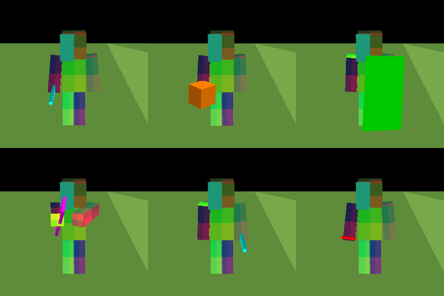

# BlueMap Live – Phase 4: gehaltene Items und Item-Animationen

Stand: 2026-10-15 · Branch `bluemap-live` · Plan: `phase-4-plan.md`

> **Kurzfassung:** Implementiert ist Phase 1 des Auftrags: Haupt- und Nebenhand werden übertragen, die Items mit den Modellen, Texturen und Anzeige-Transformationen des Resource-Packs an den Händen dargestellt, und die Vanilla-Armposen für Halten, Blocken, Bogen, Armbrust, Dreizack, Fernrohr, Horn und Pinsel animiert. Für Essen und Trinken gibt es eine gekennzeichnete Näherung. Die Art des Armschwungs (Angriff/Abbauen/Benutzen) kommt aus Server-Ereignissen.
> - **Getestet** (automatisiert): 53 Java-Tests lokal, 60 Node-Tests, Browser-E2E mit Items 15/15 (3/3 Läufe) sowie die bisherigen Suites 22/22 und 18/18; ohne Spieler ist die Darstellung pixelgleich zum Original.
> - **CI:** `spotlessCheck test` und `release` sind auf `fbd62486` grün (Push- und PR-Lauf). Der erste Lauf auf `dc9a9b05` scheiterte an zwei Kompilierfehlern in `FabricPlayer`, die behoben sind (§6).
> - **Nicht** geprüft: Minecraft und echte Vanilla-Ressourcen.
> - **Phase 2 (Truhen):** nur Analyse, siehe §8.

---

## 1. Statusmatrix

| Funktion | Implementiert | Gebaut | Getestet | Visuell geprüft | Minecraft |
|---|---|---|---|---|---|
| Haupt-/Nebenhand, Linkshänder, Itemwechsel (Server) | ja | ja (CI) | ja (JUnit: JSON) | – | nein |
| Benutzung: Hand, `UseAction`, Ticks (Server) | ja | ja (CI) | ja (JUnit: JSON) | – | nein |
| Schwung-Art aus Fabric-Ereignissen (Angriff/Abbauen/Benutzen) | ja | ja (CI) | ja (JUnit: `SwingTracker`) | – | nein |
| Item-Assets aus dem Resource-Pack (`ItemModelBaker`, `ItemResourceIndex`, `ItemAssetUpdater`) | ja | lokal (javac mit `core`) | ja (JUnit mit synthetischem Pack, Zip, Priorität, Schreiben in alle Karten) | – | **nein** (echte Vanilla-Modelle nicht verfügbar) |
| Darstellung an den Händen (Vanilla-Transformationskette) | ja | `vite build` | ja (Node: unabhängig nachgerechnete Matrix; E2E) | ja (Screenshot-Farben, synthetische Texturen) | nein |
| Overrides (Bogen, Armbrust, Schild, Dreizack, Angel, `custom_model_data`) | ja | ja | ja (Node, E2E: Bogen, Armbrust, Schild) | teilweise | nein |
| Armposen (Vanilla) | ja | ja | ja (Node, E2E) | – | nein |
| Essen/Trinken (Näherung) | ja | ja | ja (Node, E2E) | – | nein |
| Ressourcenfreigabe, Teilen zwischen Spielern, Kartenwechsel | ja | ja | ja (Node, E2E) | – | – |

---

## 2. Datenfluss

1. **Fabric** (`FabricPlayer.update`, alle `live-player-update-interval` Ticks):
   - Haupt- und Nebenhand werden mit `ItemStack.areItemsAndComponentsEqual` verglichen; nur bei einer Änderung entsteht ein neuer `HeldItem`. Die Anzahl wird ignoriert.
   - Pro Item: ID (`Registries.ITEM.getId`), `hasGlint()`, `custom_model_data`, Armbrust geladen (`CrossbowItem.isCharged`) und mit Feuerwerk (`ChargedProjectilesComponent.contains`).
   - `Equipment` enthält zusätzlich die Haupthand (`getMainArm`) und eine ausgeworfene Angel (`fishHook != null`).
   - `ItemUse`: `isUsingItem`, `getActiveHand`, `getActiveItem().getUseAction()`, `getItemUseTime`.
2. **Schwung-Art:** Die Fabric-Ereignisse `AttackEntityCallback`, `AttackBlockCallback`, `UseBlockCallback` und `UseItemCallback` werden serverseitig beobachtet (immer `PASS`, also ohne Eingriff ins Spiel).
   - Der `SwingTracker` ordnet ein Ereignis dem Schwung zu, der im selben oder im nächsten Tick beginnt.
   - Folgeschwünge beim Abbauen bleiben `mine`, solange höchstens 8 Ticks dazwischen liegen.
   - Ein Schwung ohne Ereignis bleibt `swing`. Ein bloßer Armschwung wird also nie als Waffenaktion ausgegeben.
3. **`players.json`** (nur mit `live-player-extended-data`, Protokoll 1 bleibt):
   ```json
   "swing": {"count": 12, "arm": "right", "kind": "attack"},
   "equipment": {"mainArm": "right",
                 "mainHand": {"id": "minecraft:crossbow", "charged": true, "firework": true},
                 "offHand": {"id": "minecraft:shield"}, "fishing": true},
   "use": {"hand": "off", "action": "block", "ticks": 14}
   ```
   - Leere Hände fehlen einfach; `glint`, `customModelData`, `charged`, `firework` und `fishing` erscheinen nur, wenn sie gesetzt sind.
   - Ältere Clients ignorieren die Felder. Ohne die Felder (ältere Server, andere Plattformen) zeigt der Webclient keine Items und nur die bisherigen Animationen.
   - Pro Hand werden nur ID und Flags übertragen. Eine getrennte, versionierte Item-Datei pro Spieler wäre teurer als diese wenigen Bytes, weil der Client sie zusätzlich abrufen müsste.
4. **Item-Assets:**
   - Kommt ein Item zum ersten Mal in einer ausgelieferten `players.json` vor, schreibt der `ItemAssetUpdater` asynchron `assets/items/<namespace>/<pfad>.json` in den Speicher jeder Karte. Das ist derselbe Weg wie bei den Skins. Danach kostet jedes Item pro Abruf nur noch einen Set-Zugriff.
   - Es werden höchstens 4096 Items geschrieben.
5. **Webclient:**
   - `ItemAssetCache` (ein Cache pro Karten-Manager) lädt das Asset und baut Geometrien, Texturen und Materialien pro Item-Typ einmal. Diese werden zwischen allen Spielern geteilt und über Referenzzählung freigegeben.
   - Fehlt ein Asset noch (404), weil der Server es gerade erst schreibt, wird es nach frühestens 2 s erneut angefragt, höchstens 15 Mal. Der Anstoß kommt aus der normalen Pose-Aktualisierung; es gibt keinen eigenen Timer.

## 3. Item-Assets (`ItemModelBaker`)

**Quelle:**
- BlueMap lädt zwar alle Modelle, übernimmt aber weder `display`, `overrides` noch die Item-Texturen.
- Der `ItemResourceIndex` liest deshalb beim ersten Bedarf einmal die Modell-JSONs und die für Items relevanten Texturen (`item/`, `block/`, `entity/shield*`, alle Fremd-Namespaces) aus denselben Pack-Wurzeln wie BlueMap. Er nutzt dafür BlueMaps `Pack.loadResourcePath` (Zip, Mod-Jars, Overlays) mit derselben Priorität: Die erste Wurzel gewinnt.
- Für Vanilla sind das einige MB im Speicher.

**Auflösung wie in Vanilla:**
- Die Elternkette wird zusammengeführt: Texturen nach Schlüssel, `elements` und jeder Anzeige-Modus vom nächsten Modell, das sie definiert.
- `thirdperson_lefthand` übernimmt `thirdperson_righthand`, wenn es fehlt.
- `overrides` werden nur aus dem Item-Modell selbst gelesen.

**Flächen:**
- Erzeugt werden sie mit BlueMaps eigenen Klassen `Element`, `Face` und `Rotation` (UV-Standardwerte, Element-Rotation, Texturreferenzen) und mit derselben Eckenreihenfolge und UV-Zuordnung wie BlueMaps `ResourceModelRenderer`.
- `builtin/generated` wird wie Vanillas `ItemModelGenerator` extrudiert: eine 1 px dicke Platte (vorne/hinten) plus Seitenflächen an den Rändern deckender Pixel, zu Läufen zusammengefasst. `tintindex` ist dabei der Ebenenindex.

**Texturen:**
- Sie werden als PNG-Daten-URL eingebettet, bei animierten Texturen nur das erste Bild, höchstens 512 px groß.

**Schild (`builtin/entity`):**
- Die Geometrie entspricht Vanillas `ShieldEntityModel`: Platte 12×22×1 bei UV (0,0), Griff 2×6×6 bei UV (26,0), Textur `entity/shield_base_nopattern`.
- Die Boxen baut der Webclient mit derselben Box-UV-Funktion wie den Spielerkörper.

**Andere `builtin/entity`-Items** (Dreizack, Truhe, Banner, Köpfe, Betten, Shulkerkisten …):
- Gibt es eine flache Textur `item/<name>`, wird diese mit der Anzeige von `item/generated` verwendet (Näherung).
- Gibt es keine, wird nichts angezeigt.

**Format** (`format: 1`):
```json
{"format": 1, "item": "minecraft:bow", "textures": ["data:image/png;base64,..."],
 "models": [{"type": "quads", "quads": [...], "display": {"right": {...}, "left": {...}}},
            {"type": "quads", "predicate": {"pulling": 1, "pull": 0.65}, "quads": [...], "display": {...}}]}
```
- `quads`: pro Fläche 22 Zahlen, nämlich 4 Positionen (xyz, Block-Einheiten 0..1), 4 UVs (v = 0 oben), Textur-Index und `tintindex`.
- `models[0]` ist das Basismodell, die weiteren Einträge sind die Overrides in JSON-Reihenfolge.

## 4. Darstellung an den Händen

Jede Hand hat einen Anker (einmal angelegte Gruppen). Er folgt dem Armknochen; bei Slim-Armen wird er wie in Vanilla um 0,5 px nach außen verschoben.

Darunter liegt die Kette aus Vanillas `HeldItemFeatureRenderer` und `ItemRenderer`, in dieser Reihenfolge:
1. in den Vanilla-Modellraum (180° um x, Pixel → Blöcke)
2. Rotation x −90°, y 180°
3. Verschiebung (±1/16, 2/16, −10/16)
4. Anzeige-Transformation des Modells: Verschiebung in 1/16, begrenzt auf ±5 Blöcke; Rotation XYZ; Skalierung, begrenzt auf ±4. In der linken Hand werden die x-Verschiebung sowie die y- und z-Rotation gespiegelt (`Transformation.apply(leftHanded)`).
5. Verschiebung −0,5

Das Override ist das letzte Override, dessen Prädikate alle erreicht sind; sonst gilt das Basismodell (Vanilla-Regel). Prädikate:

| Prädikat | Wert |
|---|---|
| `pulling`, `pull` | Bogen: `ticks/20`; Armbrust: `ticks/25`, das ist die Vanilla-Ladezeit ohne Schnellladen |
| `blocking`, `throwing` | aus `use` |
| `charged`, `firework` | Flags des Items |
| `cast` | Angel in der Haupthand, sonst in der Nebenhand (Vanilla-Regel) |
| `custom_model_data` | Komponente des Items |

- Meshes entstehen nur, wenn sich Item oder Override ändern.
- Alle Item-Meshes ignorieren Raycasts; Klicks auf die Karte bleiben unverändert.


*Browser-E2E mit synthetischen, farbcodierten Texturen (oben: Schwert, Steinblock, Schild blockend; unten: Bogen gespannt, Schwert bei Linkshänder, Apfel).*

## 5. Animationen (`PlayerItemPoses.js`, im `PlayerAnimator`)

Die Armposen sind aus Vanillas 1.21.1 `PlayerEntityRenderer.getArmPose`, `BipedEntityModel.positionRightArm`/`positionLeftArm` und `CrossbowPosing` nachgebildet:

| Pose | Auslöser | Bewegung |
|---|---|---|
| ITEM | Item in der Hand | halbe Gehbewegung, leicht nach vorn (−π/10) |
| BLOCK | Schild benutzen | Arm vor dem Körper (−0,94 rad, ±30°), folgt dem Kopf begrenzt |
| BOW_AND_ARROW | Bogen spannen | beide Arme in Blickrichtung |
| CROSSBOW_CHARGE | Armbrust laden | Zugarm bewegt sich mit dem Ladefortschritt |
| CROSSBOW_HOLD | geladene Armbrust, kein Schwung | beide Arme in Blickrichtung |
| THROW_SPEAR | Dreizack spannen | Arm über den Kopf |
| SPYGLASS, TOOT_HORN, BRUSH | Fernrohr, Ziegenhorn, Pinsel | wie Vanilla |
| eat (Näherung) | Essen/Trinken | Arm zum Mund, kleines Wippen (in Vanilla 1.21.1 gibt es dafür keine Third-Person-Pose) |

- Wird ein Item benutzt, erhält wie in Vanilla nur der benutzende Arm seine Pose. Zweihändige Posen setzen die andere Hand auf ITEM bzw. EMPTY.
- **Übergänge:** Die Differenz zur Gehpose wird mit τ = 60 ms überblendet, deshalb springt die Pose bei einem Itemwechsel nicht.
- **Benutzungszeit:** Sie läuft zwischen zwei Abtastungen mit der eigenen Uhr weiter und wird nur korrigiert, wenn sie mehr als 0,3 s vom Server abweicht.
- **Schlag, Abbauen, Werfen, Benutzen:** Vanilla zeigt in der Third-Person-Ansicht dafür denselben Armschwung. Er wird mit dem Item in der Hand abgespielt; die Art (`swing.kind`) steht dem Client zur Verfügung.
- **Hohe Bildrate:** Sie wird nur angefordert, solange eine Benutzung läuft oder eine Pose überblendet. Stilles Halten bleibt bei den normalen etwa 20 fps.

## 6. Tests

**Automatisiert ausgeführt**

| Test | Ergebnis |
|---|---|
| Lokal `javac` + JUnit (`core` und BlueMap-API mitkompiliert, ohne SQL-Speicher; Lombok 1.18.32 mit geprüfter SHA-1; BlueNBT aus dem Quelltext v3.5.0): Pakete `live`, `plugin.items` und `WebFilesManagerTest` | **53/53** |
| … darin `LivePlayersJsonTest` | inkl. `testEquipmentAndUse` |
| … darin `SwingTrackerTest` | inkl. Schwung-Arten |
| … darin `LivePlayersDataSupplierTest` | inkl. `testHeldItemsAreRequested`; lief damit erstmals auch lokal |
| … darin `ItemModelBakerTest` | generierte Items, Elternkette, Block-Item, Overrides, Schild, ungültige IDs |
| … darin `ItemResourceIndexTest` | Priorität, Zip, erstes Animationsbild |
| … darin `ItemAssetUpdaterTest` | jedes Item einmal in alle Karten, Ressourcen einmal geladen, ungültige IDs, „noch nicht bereit“ |
| … darin `WebFilesManagerTest` (aus `c81b46b9`) | lief damit erstmals auch lokal |
| `npm test` | **60/60**. Neu: `PlayerItemPoses.test.mjs` (Posen, Vanilla-Winkel, Prädikate, Override-Auswahl, Animator: Itemwechsel weich, Bogen mit eigener Uhr, Essen, Reset), `ItemAssets.test.mjs` (Quad-Geometrie, Teilen und Freigeben, erneute Anfrage ohne Timer, ungültige Assets, **Transformationskette gegen eine unabhängig nachgerechnete Vanilla-Matrix**, Spiegelung links, Slim-Versatz, Itemwechsel/Overrides/leere Hände/`dispose`) sowie neue Parser-Fälle |
| ESLint auf allen geänderten/neuen JS-Dateien und Tests | ok |
| `npm run build` | ok |
| Browser-E2E `items-e2e.mjs` (neu; Assets vom echten `ItemModelBaker`) | **15/15, 3/3 Läufe**: leere Hände; Schwert an der rechten Hand (Pixel); Wechsel zu Block (Pixel, Schwert freigegeben); Schild blockend (Override, Pose, Pixel); Bogen (Overrides folgen der Benutzungszeit); Armbrust geladen/ladend; Essen; Angriff mit Schwung-Art; Linkshänder (Pixel); Slim-Versatz; zwei Spieler mit geteilten und freigegebenen Assets; Kartenwechsel ohne Neuladen (alter Cache freigegeben, keine doppelten Modelle); Entfernen/Hinzufügen; Asset erst später verfügbar; Kamera unverändert, keine Seitenfehler |
| `player-e2e.mjs`, `animation-e2e.mjs` | **22/22**, **18/18** |
| Regression gegen den Original-Webclient (ohne Spieler) | **0 abweichende Pixel** |
| Richtungsprüfung Schwert (Node, Asset vom Testserver) | Griff an der Hand, Klinge zeigt nach vorn und leicht nach oben (0, 0,14, 0,99) |

| GitHub Actions `spotlessCheck test` + `release` | `dc9a9b05`: **fehlgeschlagen**, zwei Kompilierfehler in `FabricPlayer`. `Registries.ITEM.getId` scheiterte am von Fabric injizierten Registry-Interface (jetzt: `stack.getRegistryEntry().getKey()`); die Record-Komponente von `CustomModelDataComponent` hat in Yarn 1.21.1 keinen Namen (jetzt: Intermediary-Name `comp_2382()`). `fbd62486`: **grün** (Push- und PR-Lauf) |

**Nicht ausgeführt**

| Test | Grund |
|---|---|
| Item-Assets mit den echten Vanilla-Ressourcen | Client-Jar nicht herunterladbar; getestet mit synthetischen Modellen in Vanilla-Struktur |
| Alles in Minecraft | keine Minecraft-Umgebung; manuelle Tests I1–I16 in `singleplayer-test.md` |

## 7. Bekannte Einschränkungen

- **Aus dem Gedächtnis nachgebildet:** Die Vanilla-Formeln (Armposen, Transformationskette, `ShieldEntityModel`, `ItemModelGenerator`, Override-Regel) wurden nachgebildet, ohne den dekompilierten Minecraft-Quelltext in dieser Umgebung vorliegen zu haben. Die Kette ist in sich konsistent geprüft (Node-Matrixtest); ob sie Vanilla exakt trifft, zeigt erst der Vergleich in Minecraft (I1–I4).
- **Nicht dargestellt:** Färbung (`tintindex`, z. B. Leder, Tränke, Gras- und Laub-Blockitems: ungefärbt), Verzauberungsglanz, Bannermuster auf Schilden.
- **Fernrohr:** Vanilla zeigt es beim Benutzen am Auge; hier bleibt es in der Hand.
- **`builtin/entity`-Items** ohne flache Textur (Truhe, Shulkerkiste, Banner, Köpfe, Betten) werden nicht angezeigt. Der Dreizack erscheint als flaches Item.
- **Schnellladen** der Armbrust ist nicht berücksichtigt; die Pose geht von 25 Ticks aus.
- **Schwung-Art beim Abbauen:** Ein Schwung in die Luft innerhalb von 8 Ticks nach dem Abbauen gilt noch als `mine`.
- **Item-Assets bleiben gespeichert**, wenn sich der Resource-Pack ändert. Erst nach einem Neuladen von BlueMap werden sie beim nächsten Bedarf neu geschrieben.

## 8. Phase 2 – Truhen und interaktive Blöcke: Analyse

**Warum Truhen nicht einfach im Webclient animiert werden können:**
- BlueMap rendert Truhen über eigene Ressourcen-Erweiterungen (`core/src/main/resourceExtensions/.../blockstates/chest.json`, `models/entity/chest/*.json`) **geschlossen** in die Hires-Kacheln.
- Ein im Webclient animierter Deckel würde zusätzlich über dem gebackenen, geschlossenen Deckel liegen. Dieser lässt sich ohne Eingriff in die Kacheldarstellung nicht ausblenden.

**Verlässliche Zustände sind serverseitig vorhanden** (Namen gegen Yarn 1.21.1 geprüft):

| Block | Zustand |
|---|---|
| Fass | Blockzustand `BarrelBlock.OPEN` |
| Truhe, Doppeltruhe | `ChestBlockEntity.getPlayersLookingInChestCount(world, pos)`; die Geometrie folgt dem Blockzustand `type` |
| Endertruhe | `EnderChestInventory.isActiveBlockEntity(…)` |
| Shulkerkiste | `ShulkerBoxBlockEntity.getAnimationStage()` / `getAnimationProgress(…)` |

**Optionen für die Darstellung** (entschieden: **Option 1**):
1. **Teil der Live-Block-Updates (Plan-Phase 4/5):** Geöffnete Truhen werden beim Kachel-Update ohne Deckel gerendert; der Deckel wird als animiertes Objekt im Webclient ergänzt. Das ist sauber, setzt aber Kachel-Updates voraus.
2. **Laufzeit-Ausblendung im Webclient:** Die Dreiecke des gebackenen Deckels an der Blockposition werden in der geladenen Kachelgeometrie ausgeblendet, solange die Truhe offen ist. Das ist ein Eingriff in die vom Original geladene Kachelgeometrie und widerspricht der Vorgabe, den Renderer nicht zu verändern.

**Vorgehen:** Truhen und interaktive Blöcke werden zusammen mit den Live-Block-Updates umgesetzt, erst nachdem Phase 1 in Minecraft bestätigt ist.
